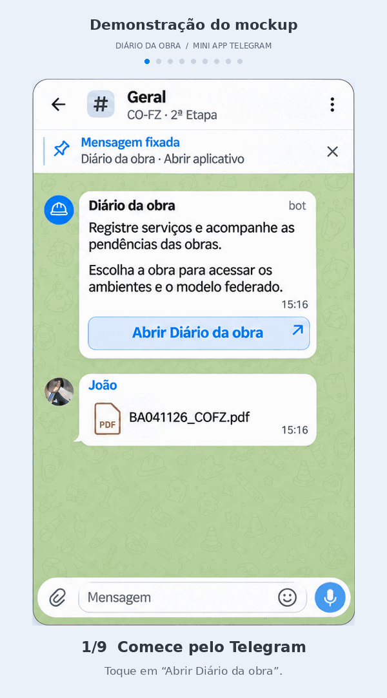

# Mini App CO-FZ — Diário da obra

Proposta de Mini App para Telegram destinada ao acompanhamento das obras do grupo CO-FZ. O fluxo começa no tópico **Geral**, abre a lista de obras e permite escolher a **HTO**, consultar ambientes, visualizar a proposta de modelo federado e registrar serviços ou pendências com fotos.

**Estado atual:** mockups, demonstração animada, planejamento e diagnóstico exploratório dos documentos HTO. O Mini App e o bot ainda não estão implementados para uso operacional. A integração IFC/planta 2D está pausada; a federação dos modelos permanece em validação.

## Demonstração

O GIF apresenta nove etapas, incluindo a abertura pelo Telegram, escolha da obra, visualizador, histórico, novo registro, pendências e tela de encerramento. Duração: aproximadamente 36 segundos. A navegação é simulada com os mockups.



[Baixar GIF](docs/mockups/demo-mini-app-v2.gif) · [Ver roteiro completo](docs/mockups/demo-preview-v2.png)

## Telas propostas

- [Entrada pelo tópico Geral e seleção da obra](docs/mockups/entrada-telegram-v2.png).
- [Ambientes, histórico, registros e pendências](docs/mockups/mini-app-v2.png).
- [HTO → visualização do modelo federado](docs/mockups/hto-modelo-federado-v1.png), com ARQ, ELT, HID, ESG, DRE, PCI, VES, TLD e ANT.
- [Documentação dos mockups e prompts de geração](docs/mockups/README.md).

## Organização

| Diretório | Conteúdo |
| --- | --- |
| `docs/mockups/` | Imagens, GIFs, prompts e script de montagem da demonstração |
| `tasks/` | Plano e checklist de execução |
| `artifacts/validation/` | Inventários, evidências e scripts de diagnóstico PDF/IFC |
| `tests/` | Testes dos cálculos de geometria e registro |
| `dashboard/` | Painel local de acompanhamento do desenvolvimento |
| `DOCS HTO/` | PDFs originais e instruções para fornecer os modelos IFC |

As capturas `Screenshot*.png` na raiz são as referências visuais fornecidas para os mockups. Os dois PDFs originais estão em [DOCS HTO/PDF](DOCS%20HTO/PDF/). Os modelos IFC são mantidos separadamente; consulte [DOCS HTO/README.md](DOCS%20HTO/README.md).

## Reproduzir o GIF

Python 3 e as fontes DejaVu Sans são necessários. A montagem utiliza as imagens já incluídas no repositório.

```bash
python3 -m venv .venv
.venv/bin/pip install -r docs/mockups/reproduce/requirements-demo.txt
.venv/bin/python docs/mockups/reproduce/build_demo.py
```

Saídas: `docs/mockups/demo-mini-app-v2.gif` e `docs/mockups/demo-preview-v2.png`.

## Diagnóstico e testes

As evidências geométricas e suas limitações estão em [docs/validacao-hto.md](docs/validacao-hto.md). Os resultados são exploratórios; não representam aprovação de engenharia ou integração concluída.

```bash
python3 -m venv .venv
.venv/bin/pip install -r artifacts/validation/ifc/reproduce/requirements.txt pytest
.venv/bin/python -m pytest tests -q
```

Os testes usam exemplos geométricos e inventários incluídos. A inspeção PDF pode ser reproduzida com os originais incluídos e as dependências em `artifacts/validation/pdf/reproduce/requirements.txt`. Para executar novamente a conversão IFC, forneça os modelos nos caminhos documentados. O [painel de desenvolvimento](dashboard/README.md) funciona localmente com `python3 dashboard/serve.py`; ele não é o Mini App.

Próximas entregas e requisitos estão em [tasks/plan.md](tasks/plan.md) e [tasks/todo.md](tasks/todo.md).
