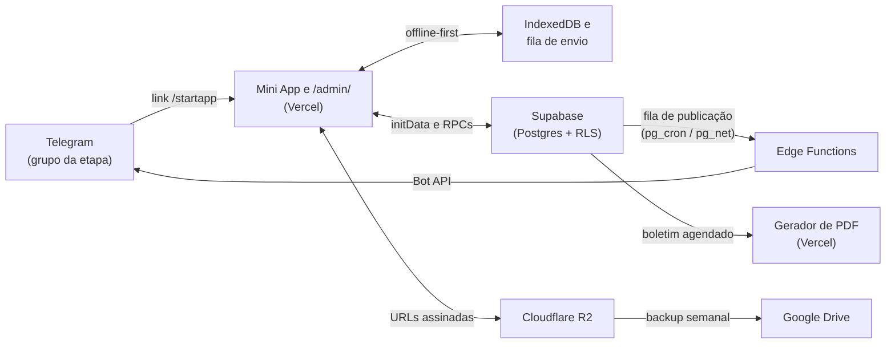
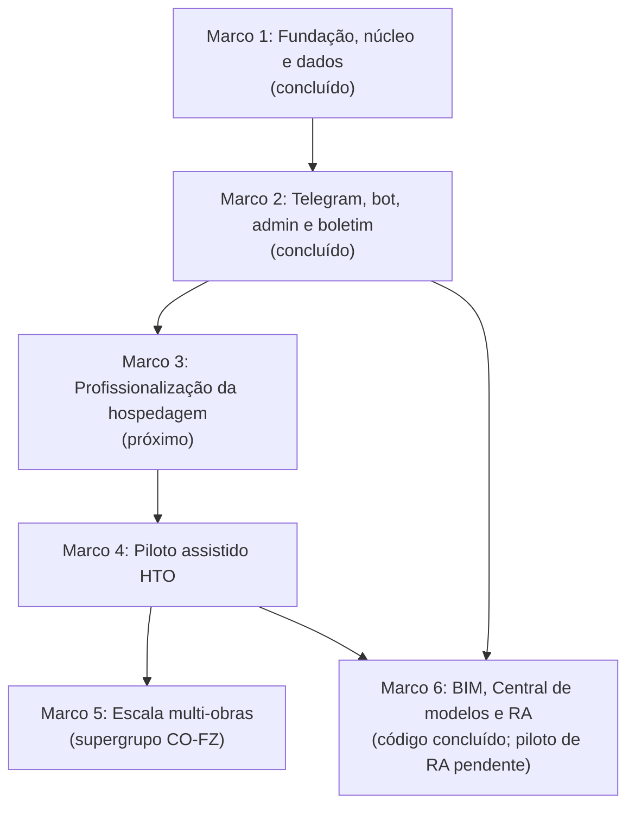

# Roadmap do Projeto — Fiscal Bot CO-FZ (Diário da Obra)

Documento de planejamento geral: visão, arquitetura, situação por módulo, marcos e riscos. O detalhe de cada tarefa fica em `tasks/todo.md`; os custos de hospedagem, em `docs/custos-hospedagem.md`.

Atualizado em 2026-11-23.

---

## 1. Visão do Produto e Arquitetura

O **Fiscal Bot** (antes "Diário da obra") é um Mini App do Telegram para o acompanhamento diário e a fiscalização das obras da CO-FZ, com um site de administração em `/admin/`.

### 1.1 Fluxo Operacional
1. **Entrada pelo Telegram:** mensagem fixada com botão no tópico *Geral* do grupo da etapa ou link direto (`t.me/diarioobra_cofz_bot/fiscalcofz`).
2. **Início:** abas por etapa do campus; por obra, contagem de serviços, pendências abertas e resolvidas.
3. **Obra:** pendências, prévia do modelo 3D, pavimentos com lista de ambientes ou planta com pinos, observações do dia.
4. **Ambiente:** histórico, pendências, "Onde fica", "Visualizar modelo" e comparação com o modelo em RA.
5. **Registro de campo:** fotos (câmera própria no Android), tipo Serviço ou Pendência, legenda; compressão no aparelho sem EXIF/GPS.
6. **Sinal instável:** rascunho no IndexedDB e envio em segundo plano, sem duplicar.
7. **Publicação:** fotos e dados no tópico da obra no grupo da etapa.
8. **Encerramento de pendência:** qualquer participante da obra, com foto de comprovação, publicado como resposta à mensagem original.
9. **Equipe de serviço:** check-in e check-out por localização, com aviso no grupo.
10. **Relatórios:** boletim diário por etapa (PDF automático às 23:30, com clima e retificação), painel e PDF de pendências.

### 1.2 Arquitetura Técnica
- **Frontend:** React + Vite + TypeScript na Vercel (Mini App e `/admin/` no mesmo build), módulos por contexto (`app/src/modules/*`) com regras de fronteira no lint, Service Worker e IndexedDB.
- **Servidor na Vercel:** `app/api/` gera o boletim e o relatório de pendências em PDF (Chromium).
- **Banco:** Supabase `miniappcofz-dev` (banco único e oficial, PostgreSQL 17, RLS por participação, `pg_cron` e `pg_net`).
- **Edge Functions:** `auth-telegram`, `bot-webhook`, `publish-outbox`, `admin-sessao`, `admin-excluir-obra` e `armazenamento` (assina leitura e envio no R2 e faz a manutenção de arquivos).
- **Arquivos:** Cloudflare R2 (`miniappcofz-arquivos`) para fotos, plantas, originais, modelos `.frag`, documentos, boletins e relatórios; backup semanal para o Google Drive pelo GitHub Actions.
- **Pipeline de dados (Python):** `extrair_ambientes.py`, `gerar_plantas.py`, `gerar_seed.py`, `gerar_geometria.py`, `publicar_plantas.py`.
- **BIM e RA:** visualizador federado `.frag` (`@thatopen/components` e `@thatopen/fragments`), Central de modelos no admin (inspeção, cortes, medições, documentos, issues e BCF) e RA parada no registro de fotos.

---

## 2. Matriz de Status Atual

| Módulo | Estado | Falta para concluir |
| :--- | :--- | :--- |
| 0–1. Fundação e dados HTO | Concluído | — |
| 2. Banco, RLS e login Telegram | Concluído e em produção | — |
| 3–4. Navegação, registro e histórico | Concluído e em produção | Teste no celular |
| 5. Sinal instável | Concluído | Conferir Android sem sinal no Telegram real |
| 6. Bot e publicação | Concluído e em produção | Conferir o link de volta (`startapp`) |
| 7. Pendências e gestão | Concluído | Teste real do encerramento publicado como resposta |
| Novas obras (COFZ) | Concluído | Revisão humana da prova; tópicos da COFZ e da ADM |
| Site de administração | Concluído | Testes de fumaça (planta, modelo, arquivar) |
| Boletim diário e Relatórios | Concluído | Acompanhar uma emissão automática real; dados administrativos da 2ª ETAPA |
| Equipe de serviço | Concluído | Teste de check-in no celular |
| 9. Modelo federado | Concluído | — |
| 10. RA | Código pronto | RA0 no aparelho, QRs fixados, piloto em campo (RA5) |
| Central de modelos | Concluído (etapas 0–8) | Preenchimento das paredes na planta; testes do usuário |
| Arquivos no R2 | Concluído | Remoção real de órfãos; retenção dos relatórios exportados |
| Arquitetura modular | Concluído | — |
| Novo visual | V0, V1 e redesign "Farda" | Conferir o que resta de V2 a V5 |
| **Backup do Postgres** | **Não feito** | Plano pago do Supabase ou dump agendado, e teste de restauração |
| **8. Piloto assistido HTO** | **Não iniciado** | Grupo real, equipe, testes em Android e iPhone, aceite |

Situação do banco em 2026-11-23: 4 obras, 2 etapas, 7 usuários, sem registros, boletins nem publicações (dados de teste apagados).

---

## 3. Marcos

### Marco 1 — Fundação, núcleo e dados (concluído)
Scaffold, CI, banco com RLS, RPCs idempotentes, pipeline das plantas, navegação, registro com fotos e operação sem sinal.

### Marco 2 — Telegram, bot, admin e boletim (concluído)
Login real, bot e publicação nos tópicos, gestão de acessos, site `/admin/`, etapas, boletim diário, Relatórios, equipe de serviço, virada dos arquivos para o R2 e reorganização modular do código.

### Marco 3 — Profissionalização da hospedagem (próximo)
1. Contratar Supabase Pro (backup diário, sem pausa por inatividade) e Vercel Pro (uso comercial). Estimativa em `docs/custos-hospedagem.md`.
2. Backup do Postgres com teste de restauração.
3. Domínio próprio (opcional) e alerta de gastos nos três serviços.

### Marco 4 — Piloto assistido HTO
1. Grupo real com equipe e gestores cadastrados; nomes de exibição.
2. Testes em Android e iPhone reais: câmera, permissões, WebView, rascunho depois de fechar, desempenho, tela cheia.
3. Acompanhar a fila de publicações e o primeiro boletim real.
4. Aceite do fluxo com a equipe da obra.

### Marco 5 — Escala multi-obras
1. Vincular as obras no supergrupo CO-FZ (um tópico por obra).
2. COFZ e ADM: revisão da planta e tópicos.
3. Novas obras pelo site (`/admin/`) ou pelo pipeline Python.

### Marco 6 — BIM, Central de modelos e RA
Código concluído. Falta o RA0 no aparelho, cadastrar e fixar os QRs, o piloto em quatro ambientes com medição do erro e os pontos em aberto da Central (preenchimento das paredes na planta, seta do minimapa).

---

## 4. Matriz de Riscos e Mitigações

| Risco | Impacto | Mitigação |
| :--- | :--- | :--- |
| **Banco sem backup fora do Supabase** (plano atual sem backup diário). | Alto | Plano Pro (backup diário de 7 dias) e dump próprio para o R2, com teste de restauração. |
| **Plano gratuito pausa ou limita o serviço** (Supabase pausa projeto parado; Vercel Hobby não permite uso comercial). | Alto | Planos pagos antes do piloto (Marco 3). |
| **Limitações do WebView do iPhone** (sem Service Worker). | Médio | A fila em IndexedDB funciona sem o Service Worker; só a abertura sem sinal fica restrita ao Android. |
| **Respostas ambíguas da API do Telegram.** | Médio | Estado `incerto` na fila e "Reenviar/marcar como publicada" na Gestão. |
| **Mudança de código de ambiente depois dos registros.** | Alto | Códigos imutáveis, revisões de planta com `manter_codigo` e ambientes inativos preservando o histórico. |
| **Memória dos celulares com modelos 3D.** | Médio | `.frag` com cache por hash, corte em volta do ambiente e chunks do visualizador fora do precache. |
| **Dependência de uma pessoa para operar** (segredos, BotFather, Cloudflare). | Médio | Procedimentos em `docs/admin.md` e `tasks/virada-r2.md`; Claude Team para a equipe manter o projeto. |

---

## 5. Próximos Passos Imediatos

1. [ ] Contratar Supabase Pro e Vercel Pro e ligar os alertas de gasto.
2. [ ] Backup do Postgres e teste de restauração.
3. [ ] Rodada de testes no celular (itens "Usuário:" de `tasks/todo.md`).
4. [ ] Nomes de exibição, prova da COFZ, tópicos da COFZ e da ADM, nome "Fiscal Bot" no BotFather.
5. [ ] Grupo real e início do piloto da HTO.
