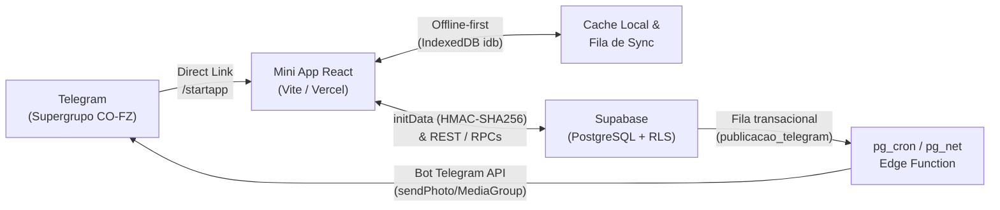
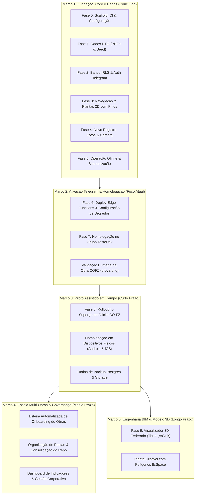

# Roadmap do Projeto — Mini App CO-FZ (Diário da Obra)

Documento oficial de planejamento, marcos evolutivos e acompanhamento do desenvolvimento do Mini App para Telegram do grupo CO-FZ.

---

## 1. Visão do Produto e Arquitetura

O **Mini App CO-FZ** é uma ferramenta móvel integrada ao Telegram destinada ao acompanhamento diário, fiscalização e registro de serviços e pendências nas obras do grupo CO-FZ.

### 1.1 Fluxo Operacional
1. **Entrada pelo Telegram:** Via mensagem fixada com botão de URL no tópico *Geral* ou Direct Link (`t.me/<bot>/<app>`).
2. **Seleção de Contexto:** Usuário seleciona a **Obra** autorizada $\rightarrow$ **Pavimento**.
3. **Localização:** Navegação por lista alfabética de ambientes ou visualização da **Planta 2D com pinos indicativos** (zoom, pan e centralização).
4. **Ambiente:** Consulta ao histórico cronológico e às pendências abertas do local.
5. **Registro de Campo:** Criação de novo registro fotográfico (Serviço ou Pendência), com compressão automática no cliente e remoção de metadados sensíveis (EXIF/GPS).
6. **Operação com Sinal Instável (Offline-first):** Gravação imediata em IndexedDB e envio assíncrono em segundo plano assim que a conectividade for restabelecida.
7. **Publicação no Telegram:** Envio automático das fotos e dados ao tópico específico da obra no supergrupo CO-FZ.
8. **Encerramento de Pendências:** Ação restrita a gestores, exigindo foto de comprovação e respondendo à mensagem original do tópico.

### 1.2 Arquitetura Técnica
- **Frontend:** React + Vite + TypeScript (hospedado na Vercel), integrado com `@telegram-apps/sdk` / `window.Telegram.WebApp`, TanStack Query, `idb` (IndexedDB) e Service Worker para precache.
- **Backend / BaaS:** Supabase (`miniappcofz-dev`, PostgreSQL 17 + RLS rigorosa baseada em participação, Storage privado com URLs assinadas e Edge Functions Deno).
- **Edge Functions:**
  - `auth-telegram`: Validação de `initData` (HMAC-SHA256) e sincronização de perfil/papel via `getChatMember`.
  - `bot-webhook`: Processamento de comandos administrativos (`/vincular_obra`, `/fixar_botao`, `/start`).
  - `publish-outbox`: Despacho da fila de saída para a Bot API do Telegram via `pg_cron`/`pg_net`.
  - `assinar-envio-plantas`: Upload seguro de derivados de plantas e recortes.
- **Pipeline de Dados (Python CLI):** PyMuPDF (`fitz`) para leitura de plantas PDF, pareamento automatizado de cômodos com áreas `A=xx m²`, geração de WebP/HD e seeds SQL (`extrair_ambientes.py`, `gerar_plantas.py`, `gerar_seed.py`, `publicar_plantas.py`).
- **Módulo Futuro BIM:** Visualizador 3D Three.js alimentado por recortes GLB extraídos de modelos IFC2X3 via IfcOpenShell.



---

## 2. Matriz de Status Atual

| Fase / Módulo | Escopo Principal | Estado Atual | Próximo Passo para Conclusão |
| :--- | :--- | :--- | :--- |
| **Mockups & Demo** | Telas conceituais, GIF de 36s e roteiros visuais. | **Concluído (100%)** | Entregue em `docs/mockups/`. |
| **0. Fundação** | Scaffold Vite/React, Supabase, Vercel, CI no GitHub Actions. | **Concluído (95%)** | Desativar Vercel Authentication para liberar acesso ao Telegram. |
| **1. Dados HTO** | Extração de 87 ambientes de DE017/DE018, plantas WebP, seed SQL. | **Concluído (100%)** | Entregue em `data/hto/` e aplicado no banco. |
| **2. Schema & Auth** | Migrations com RLS, RPCs idempotentes, função `auth-telegram`. | **Concluído (90%)** | Cadastrar `TELEGRAM_BOT_TOKEN` e testar com `initData` real. |
| **3. Navegação** | Lista de ambientes, `PlantaViewer` SVG com pinos, testes Playwright. | **Concluído (95%)** | Validar carregamento com URLs assinadas em produção. |
| **4. Registros & Fotos** | Câmera, galeria, compressão client-side $\le$ 1920px, histórico. | **Concluído (95%)** | Teste integrado com storage remoto e sessão real. |
| **5. Sinal Instável** | IndexedDB, cache de dados por 7 dias, fila em segundo plano. | **Concluído (95%)** | Homologar WebView real (Android e limitações do iOS). |
| **6. Bot & Publicação** | `bot-webhook`, `publish-outbox`, vínculo de tópicos no grupo. | **Concluído (80%)** | Deploy das Edge Functions e vínculo do tópico `TesteDev`. |
| **7. Gestão & Pendências** | Encerramento de pendência por gestor com foto réplica, gestão de acessos. | **Concluído (85%)** | Homologar encerramento e aprovação no grupo de teste. |
| **Multi-Obras (COFZ)** | Pipeline parametrizado (`--obra`), 19 ambientes extraídos, seed gerado. | **Concluído (90%)** | Revisão humana de `prova.png` e vínculo do tópico. |
| **8. Piloto Assistido** | Testes de campo com equipe real, Android/iOS, rotinas de backup. | **Pendente** | Depende das fases 6 e 7 homologadas. |
| **Organização de Pastas** | Limpeza da raiz, padronização `DOCS *` → `obras/<slug>/`, `README.md` e `app/src/` (`miniapp/` + `shared/`). | **Planejado** | Executar fases 1–4 de `tasks/plano-organizacao-pastas.md`. |
| **9. Modelo Federado BIM** | Visualizador 3D Three.js, recortes GLB, integração 2D/3D IfcSpace. | **Planejado (Fase Final)** | Diagnósticos geométricos prontos em `artifacts/validation/`. |

---

## 3. Linha do Tempo e Marcos do Roadmap



---

### Marco 1: Fundação, Core e Dados
*Status: Concluído e Estabilizado*

- **Entregas Realizadas:**
  - Estrutura completa do frontend Vite + React + TypeScript com testes automatizados (Vitest, Playwright e ESLint).
  - Modelagem do banco de dados relacional com isolamento total via Row Level Security (RLS) por obra.
  - Implementação de RPCs transacionais seguras: `concluir_registro` (com idempotência por GUID gerado no cliente) e `encerrar_pendencia` (com bloqueio pessimista `FOR UPDATE`).
  - Pipeline de processamento de plantas com PyMuPDF, gerando imagens WebP em resolução normal e HD, recortes por ambiente e provas de conferência com marcadores SVG.
  - Suporte abrangente para modo sem conexão (IndexedDB `idb` com persistência de fotos e metadados, detecção de cota de armazenamento e sincronização automática com backoff exponencial).

---

### Marco 2: Ativação Telegram, Bot e Homologação
*Status: Foco Imediato (Semana Vigente)*

- **Objetivos:** Colocar a aplicação em funcionamento integrado com a API do Telegram no ambiente de testes.
- **Entregas Planejadas:**
  1. **Configuração de Segredos:** Cadastrar `TELEGRAM_BOT_TOKEN` nos segredos do Supabase Vault e das Edge Functions.
  2. **Deploy das Funções:** Realizar o deploy de `auth-telegram`, `bot-webhook` e `publish-outbox` no projeto `miniappcofz-dev`.
  3. **Configuração do Bot de Testes:**
     - Adicionar o bot `@diarioobra_cofz_bot` como administrador do supergrupo de testes `TesteDev`.
     - Executar `/vincular_obra hto` dentro do tópico HTO.
     - Executar `/fixar_botao` no tópico Geral para fixar a mensagem com o botão de acesso rápido.
  4. **Testes Ponta a Ponta Integrados:**
     - Abertura do app via Telegram com validação de assinatura HMAC no `initData`.
     - Criação de novo registro de serviço com foto e confirmação de postagem no tópico HTO.
     - Encerramento de pendência por gestor com postagem de foto em resposta (`reply_to_message_id`) ao registro original.
  5. **Conferência da Obra COFZ:**
     - Aprovação humana da imagem `data/cofz/plantas/R06/terreo/prova.png`.
     - Vinculação do tópico da COFZ no grupo de testes.

---

### Marco 3: Piloto Assistido em Campo (Rollout HTO)
*Status: Curto Prazo (2 a 4 semanas)*

- **Objetivos:** Habilitar a equipe de engenharia e fiscalização para uso real na obra física da HTO.
- **Entregas Planejadas:**
  1. **Migração para o Supergrupo Oficial:**
     - Entrada do bot oficial no supergrupo corporativo da CO-FZ.
     - Vinculação dos tópicos oficiais de cada obra ativa.
     - Cadastramento inicial dos administradores como gestores das respectivas obras.
  2. **Homologação em Condições de Campo:**
     - Verificação em dispositivos Android reais (permissões de câmera, galeria, navegação em WebView).
     - Verificação em dispositivos iOS / iPhone reais (comportamento de upload e políticas de suspensão de abas).
     - Validação de resiliência: simulação de fiscalização em pavimentos sem sinal (subsolo), confirmando enfileiramento local e sincronização ao alcançar a área de vivência com Wi-Fi.
  3. **Operação e Segurança:**
     - Configuração de rotina de backup diário do banco de dados e políticas de retenção no Storage.
     - Monitoramento proativo da fila de publicações para tratamento de falhas ou mensagens com status `incerto`.
     - Coleta de feedback com mestres de obras e engenheiros residentes para refinamento de usabilidade.

---

### Marco 4: Escala Multi-Obras & Governança
*Status: Médio Prazo (1 a 2 meses)*

- **Objetivos:** Padronizar o onboarding contínuo de novos empreendimentos e fornecer visão consolidada para a gestão.
- **Entregas Planejadas:**
  1. **Esteira Padronizada de Novas Obras:**
     - Documentação do rito de recepção de arquivos CAD/BIM e plantas em `DOCS <SIGLA>/PDF/`.
     - Script único de orquestração:
       ```bash
       python3 scripts/extrair_ambientes.py --obra <slug>
       python3 scripts/gerar_plantas.py --obra <slug>
       python3 scripts/gerar_seed.py --obra <slug>
       python3 scripts/publicar_plantas.py --obra <slug>
       ```
     - Rito padronizado de validação de provas visuais e homologação de nomes operacionais antes da liberação do seed.
  2. **Organização de Pastas e Consolidação do Repositório (`tasks/plano-organizacao-pastas.md`):**
     - Limpeza da raiz (`Screenshot*.png` → `docs/mockups/referencias/`).
     - Padronização de `DOCS COFZ/` e `DOCS HTO/` → `obras/<slug>/` (sem espaços/maiúsculas), com regeneração dos seeds/manifestos e atualização de E2E/scripts.
     - Atualização do `README.md` raiz e separação interna de `app/src/` em `miniapp/` e `shared/` (mantendo `admin/` isolado).
  3. **Dashboard de Indicadores & Gestão:**
     - Painel web gerencial para diretoria técnica: volume de pendências por obra, tempo médio até resolução e mapas de calor de ambientes mais demandados.
     - Gestão centralizada de solicitações de acesso e relatórios de auditoria.

---

### Marco 5: Engenharia BIM & Modelo 3D Federado
*Status: Longo Prazo (Conforme Planejamento Estratégico)*

- **Objetivos:** Integrar a inteligência geométrica tridimensional dos modelos IFC à navegação do Mini App.
- **Entregas Planejadas:**
  1. **Federação e Ajuste de Coordenadas:**
     - Consolidação das matrizes de transformação de Arquitetura (ARQ R05), Instalações Hidráulicas/Antincêndio (ANT R01) e Telecomunicações/Elétrica (TLD R00).
     - Resolução da divergência de cota altimétrica Z entre disciplinas identificada nos diagnósticos de engenharia.
  2. **Processamento Server-side com IfcOpenShell:**
     - Extração e corte volumétrico de elementos construtivos reais circunscritos a cada `IfcSpace`.
     - Geração de malhas leves em formato GLB/draco com origem local unificada para evitar perda de precisão geométrica em dispositivos móveis.
  3. **Visualizador 3D no Mini App (Three.js):**
     - Ativação do cartão *"Visualizar modelo federado"* na tela da obra.
     - Controles touch de rotação, zoom e corte transversal.
     - Seletor de disciplinas (ARQ, ELT, HID, ESG, DRE, PCI, VES, TLD, ANT).
  4. **Planta 2D Vetorial Clicável:**
     - Evolução dos pinos pontuais para polígonos de seleção baseados nas coordenadas normalizadas (`bbox_normalizada`) extraídas dos modelos.

---

## 4. Matriz de Riscos e Mitigações

| Risco Identificado | Impacto | Estratégia de Mitigação |
| :--- | :--- | :--- |
| **Limitações do WebView iOS** (suspensão de Service Worker e limites de armazenamento). | Médio | Depender primariamente do IndexedDB (`idb`) para fila de sincronização, sem assumir persistência indeterminada do Service Worker no Safari/Telegram WebView. |
| **Respostas ambíguas da API do Telegram** (timeouts durante envio de fotos). | Médio | Utilização do estado transacional `incerto` na fila `publicacao_telegram`, permitindo reconciliação visual pelo gestor antes de retentativas automáticas, evitando duplicações no grupo. |
| **Alteração de código de ambiente após início dos registros.** | Alto | Regra rígida no banco: IDs operacionais de ambientes são imutáveis e protegidos por chave estrangeira após o primeiro registro. Novas plantas entram com versionamento de revisão mantendo os IDs. |
| **Sobrecarga de memória em celulares de campo com modelos 3D.** | Alto | Manter o visualizador 3D estritamente na última fase e usar recortes GLB restritos ao ambiente em foco (pesando menos de 1–2 MB), sem carregar o IFC completo no aparelho. |

---

## 5. Próximos Passos Imediatos

1. [ ] **Homologação da Imagem de Prova COFZ:** Inspecionar `data/cofz/plantas/R06/terreo/prova.png` e aprovar os 19 ambientes.
2. [ ] **Cadastro de Variáveis de Ambiente no Supabase:** Preencher `TELEGRAM_BOT_TOKEN` e segredos das Edge Functions.
3. [ ] **Deploy das Edge Functions:** Publicar `auth-telegram`, `bot-webhook` e `publish-outbox`.
4. [ ] **Configuração do Webhook Telegram:** Apontar o webhook do `@diarioobra_cofz_bot` para a Edge Function correspondente.
5. [ ] **Vincular Tópico no Grupo de Homologação:** Executar `/vincular_obra hto` no tópico HTO e `/fixar_botao` no Geral.
6. [ ] **Executar Teste Operacional Completo:** Validar autenticação, novo registro com foto, modo offline e encerramento de pendência.
7. [ ] **Organização de Pastas (Fases 1–3 de `tasks/plano-organizacao-pastas.md`):** Mover capturas da raiz, padronizar `DOCS *` → `obras/<slug>/` com regeneração do pipeline/E2E e atualizar o `README.md`.
