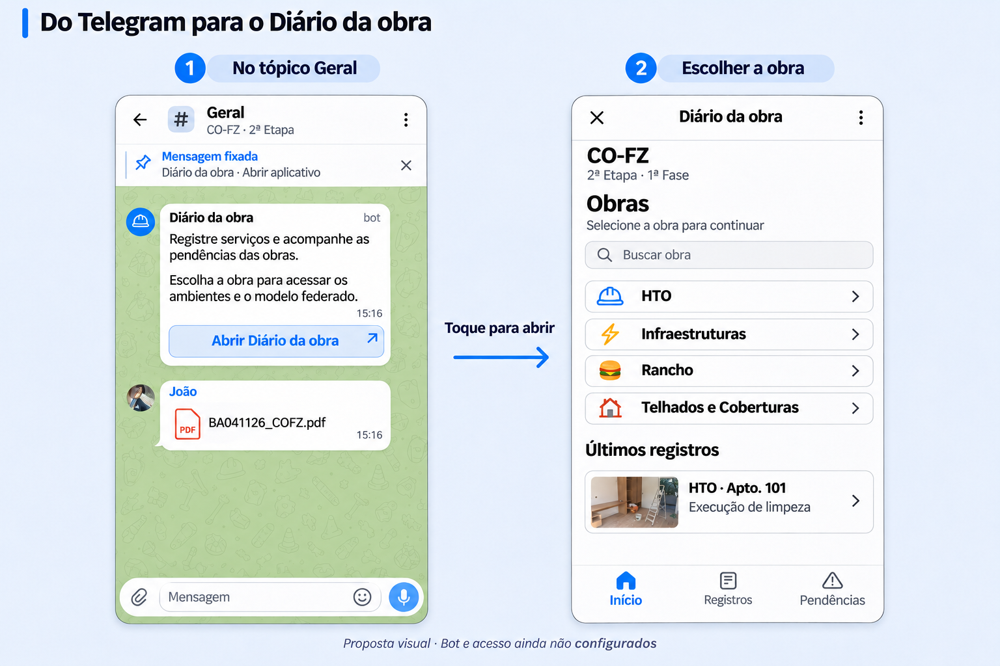
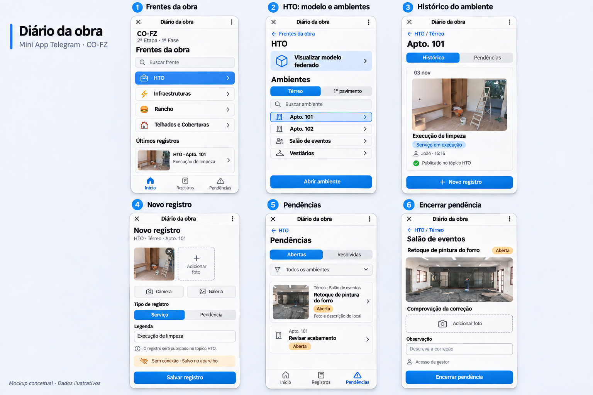
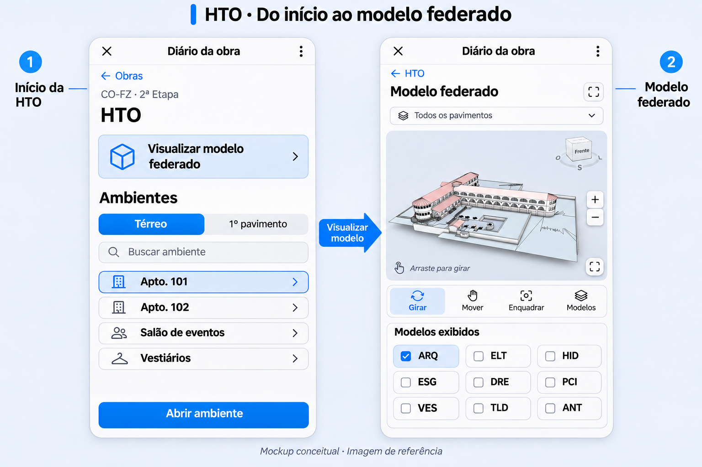

# Mockup do Mini App — proposta 2

## Boletim de Acompanhamento Diário (2026-11-13)

Prévia do boletim `BA2/261111/COFZ` em A4: [PDF](boletim-diario-v1.pdf) · páginas [1](boletim-diario-v1-p-1.png), [2](boletim-diario-v1-p-2.png), [3](boletim-diario-v1-p-3.png), [4](boletim-diario-v1-p-4.png). Plano: `tasks/plano-boletim.md`.

Cabeçalho no modelo da CO-FZ com o logo da OM; dados da obra/serviço e prazo decorrido; clima por manhã/tarde com modelo e INMET lado a lado e gráfico hora a hora; indicadores; serviços, pendências abertas e encerradas (antes/depois) com fotos; observações e responsáveis. O clima é o real do Open-Meteo para 11/11/2026 no endereço da obra; registros, fotos (marcadores cinza), indicadores e INMET são ilustrativos.

Para reproduzir: `python3 docs/mockups/reproduce/boletim/gerar.py && node docs/mockups/reproduce/boletim/render.js` (gera `boletim.html` e `boletim.pdf` na mesma pasta; Playwright com o Chromium pré-instalado).

## Demonstração em GIF

[Abrir a demonstração animada atualizada](demo-mini-app-v2.gif) · [Ver roteiro em imagens](demo-preview-v2.png)

GIF vertical de 600 × 1080, duração de 35,65 segundos, repetição contínua e tamanho de 5.969.255 bytes. Mostra: Geral → lista de obras → HTO → modelo federado → retorno à HTO → histórico do Apto. 101 → novo registro → pendências → encerrar pendência. Inclui as telas 5 e 6 do `mini-app-v2.png`, com toque na primeira pendência para abrir seu detalhe. A passagem do formulário para a lista de pendências é uma transição editorial entre fluxos demonstrativos. Termina na tela de encerramento, sem simular envio ou conclusão da pendência.

Foram conferidos visualmente os nove estados e decodificados todos os 88 quadros do GIF; duração, dimensões e repetição foram verificadas. Montagem com Pillow 13.0.0, preservando as imagens de origem. A primeira versão do GIF foi removida do repositório e está no histórico do Git.

Para reproduzir a partir da raiz do projeto:

```bash
python3 -m venv /tmp/botrelatorio-gif-env
/tmp/botrelatorio-gif-env/bin/pip install -r docs/mockups/reproduce/requirements-demo.txt
/tmp/botrelatorio-gif-env/bin/python docs/mockups/reproduce/build_demo.py
```

## Entrada pelo Telegram



Proposta atual: mensagem do bot fixada no tópico **Geral**, com botão **Abrir Diário da obra**. O botão abre a tela inicial **Obras**, com HTO, Infraestruturas, Rancho e Telhados e Coberturas. A pessoa escolhe a obra antes de acessar os ambientes e o modelo federado. Nenhuma obra é pré-selecionada. Fechar o Mini App retorna ao Telegram. Nenhuma mensagem foi enviada ou fixada nesta etapa.

Implementação futura: usar botão de URL com link `t.me` do Mini App abrindo o início, sem destino automático HTO, conforme [Direct Link Mini Apps](https://core.telegram.org/bots/webapps#direct-link-mini-apps). Não confundir com botão `web_app` restrito a conversa privada. A seleção da obra não substitui autorização no servidor e não dá acesso automático às mensagens do grupo. A publicação dos registros dependerá do bot configurado.

Gerado com `image_gen`. [Imagem atual](entrada-telegram-v2.png) · [Prompt completo](prompt-entrada-telegram-v2.txt). A versão anterior, com entrada direta pela HTO, foi substituída por esta proposta e está apenas no histórico do Git.

## Telas do aplicativo

Data: 2026-11-06. Mockup visual estático, com dados ilustrativos; não representa aplicação implementada nem publicação real no Telegram.

A integração IFC/planta 2D foi pausada a pedido do usuário. O fluxo proposto usa seleção por lista: obra/grupo → frente → pavimento → ambiente → histórico ou novo registro.

Ao abrir HTO, a proposta 2 inclui o cartão **Visualizar modelo federado**, antes da seleção de ambiente. Esse acesso é independente da integração IFC/planta 2D, que continua pausada. Nesta etapa, o cartão é uma proposta visual de navegação.



1. Frentes da obra: organização do grupo CO-FZ, incluindo HTO, Infraestruturas, Rancho e Telhados e Coberturas.
2. HTO: acesso ao modelo federado, pavimento e lista de ambientes.
3. Histórico do ambiente: foto, legenda, autoria e estado de publicação do registro.
4. Novo registro: câmera/galeria, tipo, legenda e exemplo de armazenamento local sem conexão.
5. Pendências: abertas/resolvidas, com ambiente e evidência original.
6. Encerrar pendência: ação do gestor com foto de comprovação separada da foto original.

## Tela 7 — modelo federado

### Transição HTO → modelo federado e projetos complementares



A proposta atual mostra a página inicial HTO e a abertura do visualizador lado a lado. O seletor usa somente as siglas de três letras presentes na captura de referência fornecida pelo usuário: **ARQ, ELT, HID, ESG, DRE, PCI, VES, TLD e ANT**. As nove opções aparecem simultaneamente em uma grade; apenas ARQ está selecionado no exemplo, compatível com a imagem de arquitetura. A presença das siglas no mockup não indica importação dos respectivos arquivos.

Gerado com a ferramenta integrada `image_gen`. [Imagem da transição](hto-modelo-federado-v1.png) · [Prompt completo](prompt-hto-modelo-federado-v1.txt).

### Primeira proposta do visualizador

A primeira proposta do visualizador (`modelo-federado-v1.png`) foi substituída pela transição acima e removida do repositório; a imagem e o prompt estão no histórico do Git.

Referências fornecidas pelo usuário: capturas do Telegram com os tópicos do grupo e com registros HTO e fotos (removidas do repositório; estão no histórico do Git). As pendências, estados e controles na proposta são exemplos de interface, sem afirmar defeitos reais, sincronização ou encerramento desses serviços. As fotos na prancha foram recompostas pela ferramenta de geração para referência visual.

Gerado com a ferramenta integrada `image_gen`, via skill `imagegen`. Prompt da atualização: [prompt-mini-app-v2.txt](prompt-mini-app-v2.txt). Artefato atual: [mini-app-v2.png](mini-app-v2.png). A primeira versão e seu prompt estão no histórico do Git.
