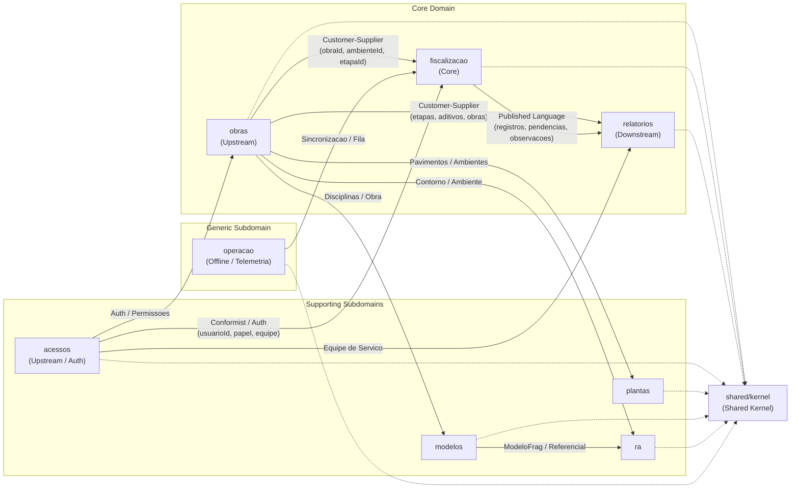
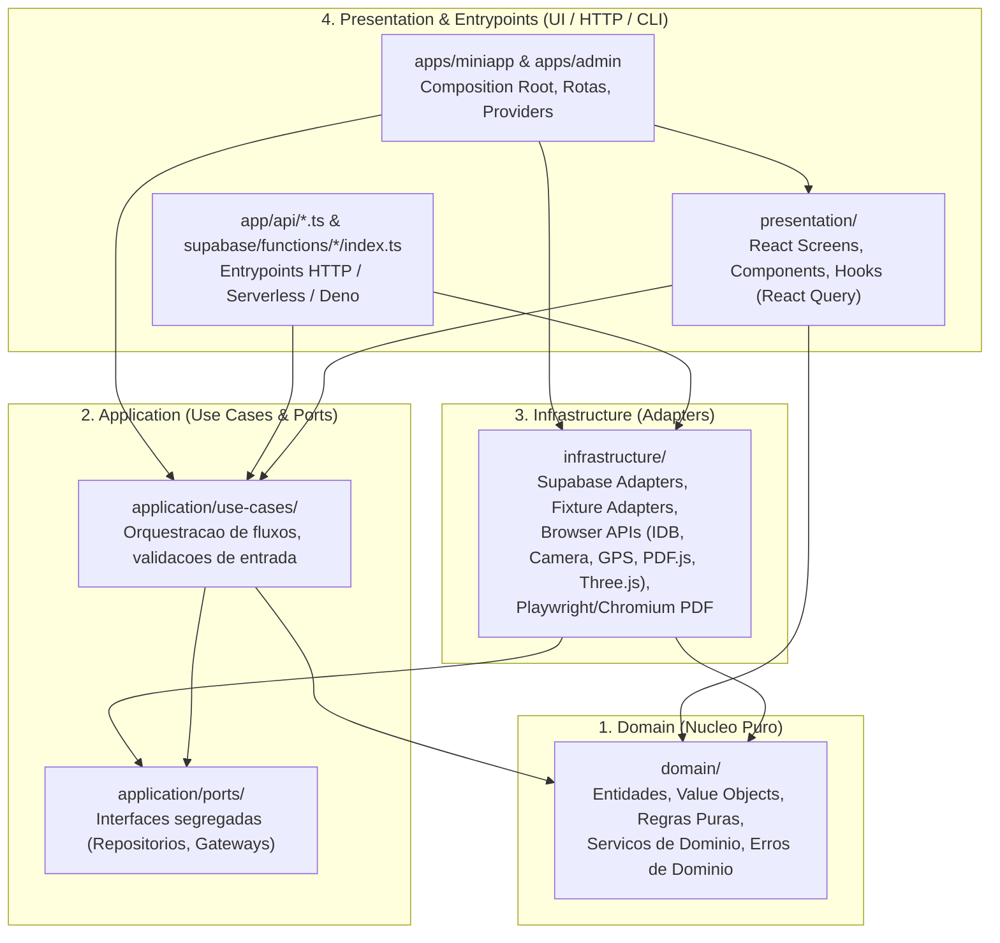
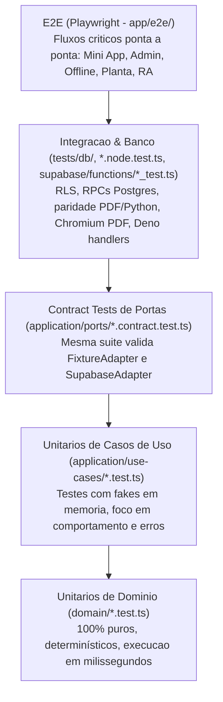
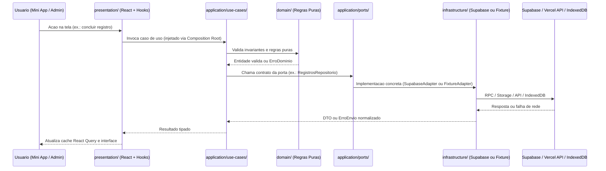
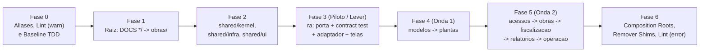

# Plano de Organização de Arquivos e Evolução Arquitetural (DDD, Clean Architecture e TDD)

> **Status:** Proposta de arquitetura e plano de migração incremental (refinada pelos princípios do `ub-mode`)  
> **Data:** 2026-11-19  
> **Escopo:** Todo o repositório (`app/`, `supabase/`, `scripts/`, `data/`, `obras/`, `docs/`, `tests/`), com foco principal na estruturação de `app/src/`.  
> **Relação com planos anteriores:** Expande e consolida o plano operacional de limpeza de pastas em [`tasks/plano-organizacao-pastas.md`](../tasks/plano-organizacao-pastas.md), introduzindo fronteiras arquiteturais explícitas de **Domain-Driven Design (DDD)**, **Clean Architecture**, **Test-Driven Development (TDD)** e disciplina de execução enxuta do **`ub-mode`**.

---

## 1. Diagnóstico do Estado Atual

O projeto evoluiu rapidamente com excelente disciplina de contratos (`docs/contrato-*.md`), boa cobertura de testes (Vitest, Playwright, Pytest, Postgres/RLS e Deno) e separação já existente entre **Mini App** (`index.html`), **Admin** (`admin.html`), **Funções Vercel** (`app/api/` + `app/servidor/`) e **Edge Functions** (`supabase/functions/`).

Entretanto, a organização atual de `app/src/` cresceu orientada a **tipo técnico de arquivo** (`telas/`, `components/`, `dados/`, `util/`), gerando quatro gargalos estruturais:

1. **Interfaces e adaptadores monolíticos ("God Repositories"):**
   - `app/src/dados/repositorio.ts` concentra ~35 operações de 8 domínios distintos em uma única interface `Repositorio`.
   - `app/src/admin/dados/repositorio.ts` concentra ~50 operações na interface `RepositorioAdmin`.
   - Como consequência, os adaptadores cresceram demais: `app/src/admin/dados/fixture.ts` (~1.731 linhas), `app/src/dados/fixture.ts` (~1.418 linhas), `app/src/dados/supabase.ts` (~1.181 linhas) e `app/src/admin/dados/supabase.ts` (~999 linhas).
2. **Mistura de regras de domínio com infraestrutura e UI:**
   - `app/src/util/` mistura lógica pura de domínio (`etapas.ts`, `painel.ts`, `periodo.ts`, `coordenadas.ts`) com detalhes de navegador/plataforma (`imagem.ts`, `localizacao.ts`, `online.ts`, `guardaSaida.ts`).
   - Diretórios como `app/src/ra/` e `app/src/modelo/` já agrupam por assunto, mas misturam matemática pura (`geometria.ts`, `pose.ts`, `corte.ts`), adaptadores de hardware/storage (`camera.ts`, `motor.ts`, `cacheModelo.ts`) e componentes React (`TelaRA.tsx`, `VisualizadorModelo.tsx`) no mesmo nível.
3. **Fronteira implícita entre Mini App, Admin e código compartilhado:**
   - `app/src/admin/` importa utilitários e componentes espalhados pela raiz de `app/src/`. Embora `app/vite.config.ts` (`arquivosSoDoAdmin`) proteja o `precache-manifest.json` no build, o acoplamento em tempo de desenvolvimento não é visível nem bloqueado por lint.
4. **Ruído na raiz do repositório:**
   - `DOCS COFZ/` e `DOCS HTO/` ainda usam espaços e maiúsculas (pendente da Fase 2 de `tasks/plano-organizacao-pastas.md`).

### O que já funciona bem e será preservado

- **Deploy na Vercel (`Root Directory = app/`):** não criar monorepo artificial (`apps/` / `packages/`). Manter `app/api/*.ts` como entrypoints finos das funções serverless.
- **Padrão `index.ts` → `handler.ts` + `handler_test.ts`** nas Edge Functions em `supabase/functions/` (*código já claro e local: manter intacto*).
- **Separação `api/*.ts` → `servidor/{boletim,relatorio}/`** (*código já claro, enxuto e bem testado em `nodenext`: manter plano, sem aninhar subpastas por dogma*).
- **Inversão de dependência via `fixture` vs `supabase`** com *tree-shaking* em tempo de build (`import.meta.env.VITE_DADOS === 'fixture'`).
- **Isolamento de bundles no Vite** (`index.html` vs `admin.html` e exclusão de chunks exclusivos do Admin no `precache-manifest.json`).

---

## 2. Premissas Arquiteturais

### 2.1 Domain-Driven Design (DDD)

O código passa a ser organizado em torno de **Contextos Delimitados (Bounded Contexts)** alinhados à **Linguagem Ubíqua** já consolidada nos contratos em `docs/contrato-*.md` e nas RPCs do Supabase:

| Contexto Delimitado | Responsabilidade (Core / Supporting / Generic) | Conceitos / Agregados principais | Origem atual aproximada |
| --- | --- | --- | --- |
| **`obras`** | **Core** — Estrutura física e contratual | `Obra`, `Etapa`, `Pavimento`, `Ambiente`, `Aditivo`, `Responsavel`, `Organizacao` | `telas/Obra*`, `admin/telas/etapa/*`, `admin/telas/obra/*`, `admin/telas/Organizacao*`, `util/etapas.ts` |
| **`fiscalizacao`** | **Core** — Execução de campo e acompanhamento | `Registro` (Serviço/Pendência), `Encerramento`, `ObservacaoDoDia`, `Foto`, `PublicacaoOutbox` | `telas/NovoRegistro*`, `telas/Registros*`, `telas/Pendencia*`, `telas/Publicacoes*`, `components/CartaoObservacoes*`, `dados/envio.ts` |
| **`acessos`** | **Supporting** — Identidade, autorização e presença | `Sessao`, `Usuario`, `PapelObra`, `SolicitacaoAcesso`, `MatrizAcessos`, `EquipeServico` (Check-in/out) | `telas/Acessos*`, `admin/telas/Pessoas*`, `admin/telas/Admins*`, `admin/telas/Entrar*`, `dados/login.ts`, `dados/nome.ts`, `components/EquipeServico*` |
| **`plantas`** | **Supporting** — Engenharia 2D e revisão de PDFs | `Planta`, `RevisaoPlanta`, `Recorte`, `SpanTexto`, `AmbienteExtraido` | `modules/plantas/*`, `modules/plantas/presentation/admin/*`, `modules/plantas/presentation/miniapp/*` |
| **`modelos`** | **Supporting** — BIM / Modelo Federado 3D | `ModeloFrag`, `Disciplina`, `PlanoCorte`, `CacheModelo` | `modelo/*`, `admin/modelo/*`, `admin/telas/modelo/*`, `telas/Modelo.tsx`, `telas/AmbienteModelo.tsx` |
| **`ra`** | **Supporting** — Realidade Aumentada em campo | `GeometriaAmbiente`, `MarcadorQr`, `Pose`, `Orientacao`, `Malha` | `ra/*`, `admin/ra/*`, `admin/telas/ra/*` |
| **`relatorios`** | **Core** — Boletim Diário, Pendências e Painel | `Boletim`, `EdicaoBoletim`, `PedidoEmissao`, `Clima`, `RelatorioPendencias`, `PainelRelatorios` | `telas/Relatorios*`, `admin/telas/boletins/*`, `util/painel.ts`, `util/periodo.ts`, `servidor/boletim/*`, `servidor/relatorio/*` |
| **`operacao`** | **Generic** — Resiliência offline e observabilidade | `FilaOffline`, `CacheConsultas`, `ErroCliente`, `ResumoOrfaos` | `offline/*`, `dados/erros.ts`, `admin/telas/Erros.tsx`, `registrarSw.ts` |

Além dos contextos, existirão dois núcleos explícitos em `app/src/shared/`:
- **`shared/kernel/` (Shared Kernel):** Value Objects transversais (`Slug`, `Periodo`, `Fuso`, `Coordenada`, `PapelAcesso`), hierarquia de erros de domínio (`ErroDominio`, `ErroEnvio`) e funções puras sem dependência de framework (`busca`, `formato`, `ordenacao`, `fuso`).
- **`shared/ui/` (Design System):** Tokens CSS (`tokens.css`, `fontes.css`), componentes visuais reutilizáveis e agnósticos de regra de negócio (`Layout`, `TopoTela`, `BarraInferior`, `Abas`, `Aviso`, `Estado`, `Icones`, `CampoBusca`, `ErrorBoundary`, `SeloVersao`).

#### Glossário Ubíquo e Estados Ilegais Irrepresentáveis

Seguindo *Model the Domain* e *Type System Discipline* (`ub-mode`), os termos abaixo são a fonte única de nomenclatura entre Mini App, Admin, RPCs e contratos (`docs/contrato-*.md`):

| Termo canônico | Significado no domínio CO-FZ | Regra de modelagem (estados ilegais irrepresentáveis) |
| --- | --- | --- |
| **`Etapa`** | Contrato/frente que agrupa obras, aditivos, responsáveis e boletins | Datas e prazos modelados com tipos válidos; fuso explícito |
| **`Obra`** | Empreendimento físico com pavimentos, ambientes, plantas e modelos | `slug` único; arquivamento explícito (`arquivada_em: string \| null`) |
| **`Ambiente`** | Unidade espacial de um pavimento onde ocorrem registros e RA | Identificado por `(obraId, codigo)` ou `id`; geometria opcional tipada |
| **`Registro`** | Ação de campo: **Serviço** executado ou **Pendência** aberta | *Discriminated union* (`tipo: 'servico'` vs `tipo: 'pendencia'` com `encerramento` só permitido em pendência) |
| **`Observação do Dia`** | Nota diária da obra, editável pelo autor até a emissão do boletim | Estado de edição explícito (`travada: boolean`) derivado do boletim do dia |
| **`Boletim` / `Retificação`** | Relatório diário oficial (PDF) publicado no Telegram; retificação gera nova revisão | Estados exclusivos (`pendente \| gerando \| emitido \| falha`), impedindo rascunho em revisão antiga |
| **`Equipe de Serviço`** | Presença em campo (check-in a até 1 km da etapa / check-out) | Serviço aberto vs encerrado modelado em união discriminada |
| **`Publicação Outbox`** | Fila de entrega de mensagens no tópico do Telegram | Status fechado (`pendente \| publicada \| incerto \| falhou`) |

#### Mapa de Contextos (Context Map)



> **Regra de comunicação entre contextos:** um contexto **nunca** importa arquivos internos de outro contexto. Toda comunicação entre contextos ocorre exclusivamente pela API pública (`index.ts` do contexto ou contratos em `domain/`/`application/ports/`), preferencialmente por IDs e DTOs imutáveis.

---

### 2.2 Clean Architecture (Regra de Dependência)

Dentro de cada contexto em `app/src/modules/<contexto>/`, os arquivos seguem até **4 camadas concêntricas** (criando `application/use-cases/` **apenas** quando houver orquestração real no cliente; operações simples de leitura/RPC consomem a porta diretamente). As dependências apontam **sempre para dentro**, aplicando *Boundary Discipline* (`ub-mode`): **validar e parsear dados externos na borda (`infrastructure/`), confiar nos tipos lá dentro e manter regras de negócio em funções puras (`domain/`)**.



#### Matriz de Dependências Permitidas e Proibidas

| Camada | Pode importar de | **Proibido** importar de |
| --- | --- | --- |
| `modules/<ctx>/domain/` | Próprio `domain/`, `shared/kernel/` | React, Vite, Supabase, DOM (`window`/`document`), `idb`, `three`, `pdfjs-dist`, `application/`, `infrastructure/`, `presentation/` |
| `modules/<ctx>/application/` | Próprio `domain/`, próprio `application/ports/`, `shared/kernel/`, contratos públicos de outros contextos | React, Supabase SDK, `infrastructure/`, `presentation/`, APIs de navegador |
| `modules/<ctx>/infrastructure/` | Próprio `application/ports/`, próprio `domain/`, `shared/kernel/`, `shared/infra/`, SDKs externos (`@supabase/supabase-js`, `idb`, `three`, `pdfjs-dist`) | `presentation/`, outros `infrastructure/` (exceto via `shared/infra/`) |
| `modules/<ctx>/presentation/` | Próprio `application/` (use cases/ports), próprio `domain/`, `shared/ui/`, `shared/kernel/`, React / React Query / React Router | `infrastructure/` (instanciação direta de Supabase/Fixture), `presentation/` de outro contexto sem contrato explícito |
| `apps/miniapp/` e `apps/admin/` | Qualquer `modules/<ctx>/` (é o **Composition Root** onde adaptadores são ligados às portas) | `apps/miniapp/` não pode importar de `apps/admin/` e vice-versa (garante `arquivosSoDoAdmin` no precache) |

---

### 2.3 Test-Driven Development (TDD)

A migração e todo desenvolvimento futuro adotam **TDD estruturado por camada**, evitando tanto a falta de testes quanto testes frágeis acoplados a detalhes de implementação:



#### Regras de TDD durante a migração

1. **Testes de Caracterização antes de mover código:** antes de refatorar um trecho de `supabase.ts`, `fixture.ts` ou uma tela complexa, garantir que exista teste cobrindo o comportamento atual.
2. **Ciclo Red → Green → Refactor em cada fatia:**
   - **Red:** escrever o teste unitário de domínio ou teste de contrato da nova porta antes de extrair a implementação.
   - **Green:** extrair/mover a implementação mínima para satisfazer o contrato.
   - **Refactor:** remover duplicações, ajustar nomes para a Linguagem Ubíqua e eliminar *shims* obsoletos.
3. **Testes colocalizados com o código-fonte:**
   - `*.test.ts` / `*.test.tsx` ao lado do arquivo testado (Vitest jsdom).
   - `*.node.test.ts` ao lado do arquivo para testes Node puros (mantendo o `exclude` atual em `app/tsconfig.app.json` e a inclusão em `app/tsconfig.testes-node.json`).
   - `*.contract.test.ts` em `application/ports/` para testar implementações de repositório contra o mesmo contrato.

---

## 3. Estrutura-Alvo de Arquivos

### 3.1 Visão do Repositório (Raiz)

```text
MINIAPPCOFZ/
├── obras/                          # (Fase 1) Substitui DOCS COFZ/, DOCS HTO/ e public/ifc/
│   ├── cofz/
│   │   ├── README.md
│   │   └── pdf/
│   └── hto/
│       ├── README.md
│       ├── pdf/
│       └── ifc/                    # Ignorado no Git (.gitignore)
├── app/                            # Root Directory na Vercel (Mini App + Admin + API Node)
│   ├── api/                        # Entrypoints finos Vercel Serverless (inalterados nas rotas)
│   │   ├── gerar-boletim.ts
│   │   ├── previa-boletim.ts
│   │   └── relatorio-pendencias.ts
│   ├── servidor/                   # Backend Node (tsconfig.servidor.json) — mantido plano e local
│   │   ├── boletim/                # Já coeso: tipos/edicao/formato (puros), gerador, http, supabase, pdf, clima
│   │   └── relatorio/              # Já coeso (6 arquivos): tipos, template, http, supabase, exemplo
│   ├── src/                        # Frontend (Mini App + Admin) — detalhado em 3.2
│   ├── e2e/                        # Testes Playwright ponta a ponta
│   ├── public/                     # sw.js e modelos locais de desenvolvimento
│   ├── scripts/                    # Utilitários Node (ifc_para_frag, publicar_modelos, etc.)
│   ├── index.html                  # Entrypoint Vite -> /src/apps/miniapp/main.tsx
│   ├── admin.html                  # Entrypoint Vite -> /src/apps/admin/main.tsx
│   ├── vercel.json
│   └── vite.config.ts
├── supabase/
│   ├── migrations/                 # Migrations SQL (inalterado)
│   ├── seed/                       # Seeds SQL (inalterado)
│   └── functions/                  # Edge Functions Deno (index.ts -> handler.ts + handler_test.ts)
│       ├── _shared/
│       ├── admin-excluir-obra/
│       ├── admin-sessao/
│       ├── assinar-envio-plantas/
│       ├── auth-telegram/
│       ├── bot-webhook/
│       └── publish-outbox/
├── scripts/                        # Pipeline Python de extração de plantas/ambientes/seeds
├── data/                           # Dados gerados e configuracoes por obra (cofz/, hto/)
├── tests/                          # Testes Python (pipeline + tests/db Postgres/RLS)
├── docs/                           # Contratos, arquitetura, ROADMAP, mockups, specs
├── tasks/                          # Checklists e planos operacionais
└── artifacts/                      # Evidências históricas de validação PDF/IFC
```

### 3.2 Estrutura-Alvo de `app/src/`

```text
app/src/
├── apps/                                   # Composition Roots (isolamento estrito de bundles)
│   ├── miniapp/
│   │   ├── main.tsx                        # Entrypoint de index.html
│   │   ├── App.tsx                         # Rotas e shell do Mini App
│   │   ├── App.test.tsx
│   │   ├── container.ts                    # Instancia adaptadores (Supabase vs Fixture) e injeta portas
│   │   └── providers.tsx                   # QueryClient, Contextos de portas, Offline, Telegram
│   └── admin/
│       ├── main.tsx                        # Entrypoint de admin.html
│       ├── AdminApp.tsx                    # Rotas e shell do Admin
│       ├── AdminApp.test.tsx
│       ├── admin.css
│       ├── container.ts                    # Instancia adaptadores Admin (Supabase vs Fixture)
│       └── providers.tsx
│
├── shared/                                 # Nucleo compartilhado (sem acoplamento a contexto)
│   ├── kernel/                             # 100% puro (zero React, zero DOM, zero SDK)
│   │   ├── erros.ts                        # ErroDominio, ErroEnvio, codigos de erro
│   │   ├── busca.ts
│   │   ├── coordenadas.ts
│   │   ├── formato.ts
│   │   ├── fuso.ts
│   │   ├── ordenacao.ts
│   │   ├── tipos.ts                        # Value Objects e tipos comuns (PapelAcesso, Posicao, etc.)
│   │   └── index.ts
│   ├── infra/                              # Adaptadores tecnicos transversais
│   │   ├── supabaseClient.ts               # Cliente/configuracao base Supabase
│   │   ├── telegram/                       # telegram.ts, telegramBack.ts
│   │   ├── browser/                        # imagem.ts, localizacao.ts, online.ts, guardaSaida.ts, telaCheia.ts
│   │   └── sw/                             # registrarSw.ts
│   ├── ui/                                 # Design System (componentes puros de apresentacao)
│   │   ├── estilo/                         # tokens.css, fontes.css, index.css
│   │   ├── layout/                         # Layout.tsx, TopoTela.tsx, BarraInferior.tsx, FaixaIdentidade.tsx
│   │   ├── feedback/                       # Aviso.tsx, Estado.tsx, ErrorBoundary.tsx, SeloVersao.tsx
│   │   ├── inputs/                         # CampoBusca.tsx, Abas.tsx, AbasEtapa.tsx, SeletorFotos.tsx
│   │   ├── midia/                          # CameraFotos.tsx, GaleriaFotos.tsx, VisualizadorFotos.tsx, useFotosEscolhidas.ts
│   │   └── icones/                         # Icones.tsx
│   └── test/                               # Infraestrutura compartilhada de testes
│       ├── setup.ts
│       └── renderApp.tsx
│
└── modules/                                # Contextos Delimitados (Vertical Slices + Clean Architecture)
    ├── obras/
    │   ├── domain/                         # Obra, Etapa, Pavimento, Ambiente, Aditivo, etapas.ts (regras puras)
    │   ├── application/
    │   │   └── ports/                      # ObrasRepositorio.port.ts, EtapasRepositorio.port.ts, OrganizacaoRepositorio.port.ts
    │   ├── infrastructure/                 # Sem use-cases/ vazios: regras de escrita vivem nas RPCs do banco
    │   │   ├── supabase/                   # ObrasSupabaseAdapter.ts, EtapasSupabaseAdapter.ts
    │   │   └── fixture/                    # ObrasFixtureAdapter.ts, EtapasFixtureAdapter.ts
    │   ├── presentation/
    │   │   ├── miniapp/                    # Obras.tsx, Obra.tsx, Ambiente.tsx, hooks
    │   │   └── admin/                      # ObrasAdmin.tsx, ObraAdmin.tsx, etapa/*, obra/*, Organizacao.tsx
    │   └── index.ts
    │
    ├── fiscalizacao/
    │   ├── domain/                         # Registro (Servico | Pendencia), Encerramento, Observacao, regras de envio/idempotencia
    │   ├── application/
    │   │   ├── ports/                      # RegistrosRepositorio.port.ts, ObservacoesRepositorio.port.ts, PublicacoesRepositorio.port.ts
    │   │   └── use-cases/                  # concluirRegistro (upload fotos + RPC idempotente), encerrarPendencia
    │   ├── infrastructure/
    │   │   ├── supabase/                   # RegistrosSupabaseAdapter.ts, StorageFotosAdapter.ts
    │   │   └── fixture/                    # RegistrosFixtureAdapter.ts
    │   ├── presentation/
    │   │   └── miniapp/                    # NovoRegistro.tsx, Registros.tsx, Pendencias.tsx, PendenciaDetalhe.tsx, Publicacoes.tsx, CartaoObservacoes.tsx, CartaoPendencia.tsx, ListaRegistros.tsx
    │   └── index.ts
    │
    ├── acessos/
    │   ├── domain/                         # Sessao, PapelObra, SolicitacaoAcesso, EquipeServico, nome.ts
    │   ├── application/
    │   │   └── ports/                      # SessaoRepositorio.port.ts, AcessosRepositorio.port.ts, EquipeServicoRepositorio.port.ts
    │   ├── infrastructure/
    │   │   ├── supabase/                   # AcessosSupabaseAdapter.ts, login.ts
    │   │   └── fixture/                    # AcessosFixtureAdapter.ts
    │   ├── presentation/
    │   │   ├── miniapp/                    # Acessos.tsx, AcessosEquipe.tsx, EquipeServico.tsx, PedidosAcesso.tsx, GuardaSessao.tsx
    │   │   └── admin/                      # Entrar.tsx, Pessoas.tsx, Admins.tsx
    │   └── index.ts
    │
    ├── plantas/
    │   ├── domain/                         # tipos.ts, extrair.ts, spans.ts, editor.ts, sinteticos.ts, metricasFonte.ts
    │   ├── application/
    │   │   ├── ports/                      # PlantasRepositorio.port.ts, ServicoPdf.port.ts
    │   │   └── use-cases/                  # extrairPlanta, publicarRevisaoPlanta (orquestracao PDF + Storage + RPC)
    │   ├── infrastructure/
    │   │   ├── pdf/                        # carregarPdfJs.ts, pdf.ts, render.ts, servicoNavegador.ts
    │   │   ├── supabase/                   # PlantasSupabaseAdapter.ts, publicar.ts
    │   │   └── fixture/                    # PlantasFixtureAdapter.ts, servicoFalso.ts
    │   ├── presentation/
    │   │   ├── miniapp/                    # AbaPlanta.tsx, PlantaViewer.tsx, OndeFica.tsx, Pino.tsx
    │   │   └── admin/                      # PlantaObra.tsx, EditorPlanta.tsx, Ambientes.tsx, NovaRevisao.tsx, Recorte.tsx
    │   └── index.ts
    │
    ├── modelos/
    │   ├── domain/                         # modelos.ts, corte.ts (regras puras de disciplina e corte 3D)
    │   ├── application/
    │   │   ├── ports/                      # ModelosRepositorio.port.ts, CacheModelo.port.ts, ConversorIfc.port.ts
    │   │   └── use-cases/                  # carregarModeloComCache (hash + IndexedDB + download)
    │   ├── infrastructure/
    │   │   ├── cache/                      # cacheModelo.ts (IndexedDB)
    │   │   ├── conversor/                  # conversor.ts, conversor.worker.ts, globais.d.ts
    │   │   ├── supabase/                   # ModelosSupabaseAdapter.ts
    │   │   └── fixture/                    # ModelosFixtureAdapter.ts
    │   ├── presentation/
    │   │   ├── miniapp/                    # VisualizadorModelo.tsx, PreviaModelo.tsx, Modelo.tsx, AmbienteModelo.tsx
    │   │   └── admin/                      # ModelosObra.tsx
    │   └── index.ts
    │
    ├── ra/
    │   ├── domain/                         # tipos.ts, geometria.ts, pose.ts, orientacao.ts, malha.ts, qr.ts, planta.ts
    │   ├── application/
    │   │   ├── ports/                      # RaRepositorio.port.ts, Camera.port.ts, LeitorQr.port.ts
    │   │   └── use-cases/                  # calibrarAmbienteRA (QR + pose + referencial 3D)
    │   ├── infrastructure/
    │   │   ├── dispositivo/                # camera.ts, leitorQr.ts, motor.ts
    │   │   ├── supabase/                   # RaSupabaseAdapter.ts
    │   │   └── fixture/                    # RaFixtureAdapter.ts
    │   ├── presentation/
    │   │   ├── miniapp/                    # TelaRA.tsx, DiagnosticoRA.tsx, ra.css
    │   │   └── admin/                      # RaObra.tsx
    │   └── index.ts
    │
    ├── relatorios/
    │   ├── domain/                         # painel.ts, periodo.ts, tipos de boletim/relatorio
    │   ├── application/
    │   │   └── ports/                      # RelatoriosRepositorio.port.ts, BoletinsAdminRepositorio.port.ts
    │   ├── infrastructure/
    │   │   ├── supabase/                   # RelatoriosSupabaseAdapter.ts, BoletinsSupabaseAdapter.ts
    │   │   └── fixture/                    # RelatoriosFixtureAdapter.ts, fixtureBoletim.ts
    │   ├── presentation/
    │   │   ├── miniapp/                    # Relatorios.tsx, PainelRelatorios.tsx, GraficoAcumulado.tsx, GraficoPorObra.tsx
    │   │   └── admin/                      # Boletins.tsx, EditorBoletim.tsx, EmitirOuPrever.tsx, Tabelas.tsx
    │   └── index.ts
    │
    └── operacao/
        ├── domain/                         # fila.ts (regras de retentativa/estado), erros de cliente, orfaos
        ├── application/
        │   ├── ports/                      # ArmazenamentoOffline.port.ts, TelemetriaRepositorio.port.ts
        │   └── use-cases/                  # sincronizarFila (retentativa idempotente + ordem)
        ├── infrastructure/
        │   ├── indexeddb/                  # armazenamento.ts, cacheConsultas.ts
        │   ├── supabase/                   # TelemetriaSupabaseAdapter.ts
        │   └── fixture/                    # TelemetriaFixtureAdapter.ts
        ├── presentation/
        │   ├── miniapp/                    # contexto.tsx, BarraSincronizacao.tsx, RegistroLocal.tsx
        │   └── admin/                      # Erros.tsx
        └── index.ts
```

> **Atenção crítica ao bundle do Vite (`precache-manifest.json`):**  
> Separar `presentation/miniapp/` e `presentation/admin/` dentro de cada contexto (e manter `apps/miniapp/` isolado de `apps/admin/`) garante que o grafo de imports a partir de `index.html` **nunca** alcance código exclusivo do Admin. Além disso, o nome dos chunks pesados excluídos em `montarManifesto` (`VisualizadorModelo`, `motor-3d`, `jsQR`, `conversor.worker`) deve ser mantido inalterado ou atualizado em conjunto com `app/vite.config.ts` e `app/vite.config.test.ts`.

### 3.3 Interligação Ponta a Ponta das Camadas



---

## 4. Plano de Migração em Fases Seguras (Zero Quebra)

### Estratégia de Segurança ("Strangler Fig" + Barrels Temporários + `ub-mode`)

Para migrar sem interromper entregas nem quebrar o deploy na Vercel ou o CI:

1. **Nunca fazer "Big Bang":** cada fase (e subfase) é um PR pequeno, revisável e reversível.
2. **Shims de compatibilidade (re-exports):** ao mover um módulo para `modules/<ctx>/` ou `shared/`, manter temporariamente um arquivo de re-export no caminho antigo até todos os consumidores serem atualizados — só então remover o arquivo antigo.
3. **Segregação *just-in-time* por fatia (*Build the Lever*):** em vez de desenhar 15 interfaces de porta especulativas antes de migrar código, cada porta nasce junto com o seu contexto. `Repositorio` e `RepositorioAdmin` passam a compor as novas portas conforme cada fatia é extraída (`interface Repositorio extends RaRepositorio, ModelosRepositorio, ...`).
4. **Isolamento do estado mutável da Fixture (*Separate Before Serializing Shared State*):** ao fatiar `fixture.ts` (1.418 linhas) e `admin/dados/fixture.ts` (1.731 linhas), cada contexto é o **único escritor** (*single writer*) da sua fatia em um `EstadoFixture` explícito em `shared/infra/fixtureState.ts` — sem mutações cruzadas ocultas entre adaptadores.
5. **Gate de verificação obrigatório ao fim de cada fase** (espelhando `.github/workflows/ci.yml`):
   ```bash
   # App (TypeScript + ESLint + Vitest + Build + Fixture Build)
   cd app && npm run typecheck && npm run lint && npm test && npm run build && npm run build:fixture

   # E2E (Playwright) + Testes de boletim com Chromium (quando aplicável)
   cd app && npm run test:e2e

   # Python + Paridade de configuração de obras
   pytest -q --ignore=tests/db && python3 scripts/importar_config_obras.py --verificar

   # Banco (quando houver alteração de contrato/SQL)
   pytest -q tests/db

   # Edge Functions (quando houver alteração em supabase/functions)
   cd supabase/functions && deno fmt --check && deno lint && deno check */*.ts && deno test
   ```

---

### Fase 0 — Rede de Segurança, Aliases e Fronteiras Automatizadas

**Objetivo:** Preparar o terreno sem alterar comportamento nem mover código de negócio.

- **Ações:**
  1. Configurar *path aliases* em `app/tsconfig.app.json`, `app/tsconfig.testes-node.json` e `app/vite.config.ts`:
     - `@shared/*` → `src/shared/*`
     - `@modules/*` → `src/modules/*`
     - `@apps/*` → `src/apps/*`
  2. Adicionar regras de fronteira em `app/eslint.config.js` (via `no-restricted-imports`) inicialmente em nível `warn` para os novos diretórios (`modules/*/domain/**` não pode importar `react`, `@supabase/supabase-js`, `infrastructure/`, `presentation/`; `apps/miniapp/**` não pode importar `apps/admin/**`).
  3. Criar estrutura inicial de pastas `app/src/shared/`, `app/src/modules/`, `app/src/apps/`.
  4. **TDD (Caracterização):** rodar a suíte completa e registrar o baseline de testes passando e o conteúdo atual de `app/dist/precache-manifest.json` (lista de arquivos excluídos do Admin).
- **Risco:** Muito baixo (apenas configuração e baseline).
- **Critério de pronto:** `typecheck`, `lint`, `test`, `build` e `build:fixture` verdes; aliases funcionando em um teste smoke.

---

### Fase 1 — Higienização da Raiz e Padronização de `obras/<slug>/`

**Objetivo:** Concluir a organização de ativos externos ao `app/src/` já prevista em `tasks/plano-organizacao-pastas.md` (Fases 2 e 3 daquele documento), eliminando diretórios com espaços e maiúsculas.

- **Ações:**
  1. Mover `DOCS COFZ/PDF/` → `obras/cofz/pdf/`, `DOCS COFZ/README.md` → `obras/cofz/README.md`.
  2. Mover `DOCS HTO/PDF/` → `obras/hto/pdf/`, `DOCS HTO/README.md` → `obras/hto/README.md` e `public/ifc/` → `obras/hto/ifc/`.
  3. Atualizar `.gitignore`, `data/hto/obra.json`, `data/cofz/obra.json`, `app/e2e/planta.spec.ts`, `artifacts/validation/pdf/reproduce/inspect_pdfs.py`, `scripts/README.md`, `CLAUDE.md` e `README.md`.
  4. Re-executar o pipeline Python (`extrair_ambientes.py`, `gerar_plantas.py`, `gerar_seed.py`, `importar_config_obras.py`) garantindo zero diff inesperado nos JSONs/seeds.
- **Risco:** Baixo (caminhos hardcoded em scripts e testes).
- **Verificação:** `pytest -q --ignore=tests/db`, `python3 scripts/importar_config_obras.py --verificar` e `cd app && npm run test:e2e -- e2e/planta.spec.ts`.

---

### Fase 2 — Extração do Shared Kernel e Infraestrutura Transversal (`app/src/shared/`)

**Objetivo:** Desacoplar utilitários puros, tokens/componentes genéricos de UI e adaptadores de navegador antes de fatiar os contextos.

- **Ações (com TDD Red → Green → Refactor):**
  1. Mover funções puras para `shared/kernel/`: `busca.ts`, `coordenadas.ts`, `formato.ts`, `fuso.ts`, `ordenacao.ts`, `erros.ts` (de `util/erros.ts` + `dados/erros.ts` separados entre modelo de erro e envio). Garantir 100% de testes unitários puros.
  2. Mover adaptadores de plataforma para `shared/infra/`: `telegram.ts`, `telegramBack.ts`, `imagem.ts`, `localizacao.ts`, `online.ts`, `guardaSaida.ts`, `telaCheia.ts`, `registrarSw.ts`.
  3. Mover componentes puramente visuais e CSS base para `shared/ui/`: `estilo/*`, `Layout`, `TopoTela`, `BarraInferior`, `Abas`, `Aviso`, `Estado`, `ErrorBoundary`, `Icones`, `CampoBusca`, `CameraFotos`, `GaleriaFotos`, `VisualizadorFotos`, `SeletorFotos`, `SeloVersao`.
  4. Manter arquivos *shim* (re-export) nos locais antigos (`src/util/*.ts`, `src/components/*.tsx`) durante a transição para não quebrar telas ainda não migradas.
- **Risco:** Baixo (re-exports preservam compatibilidade total).
- **Verificação:** `typecheck`, `lint`, `test`, `build` e inspeção do `precache-manifest.json`.

---

### Fase 3 — Alavanca / Piloto Ponta a Ponta: Contexto `ra` (*Build the Lever*) — **concluída** (2026-11-19; telas em `presentation/`, padrão em `docs/padrao-contexto-modulo.md`)

**Objetivo:** Provar todo o padrão arquitetural (porta segregada + *Contract Test* + fatiamento do adaptador Supabase/Fixture + composição na fachada `Repositorio`/`RepositorioAdmin` + unificação de duplicação entre Mini App e Admin) no menor contexto autocontido antes de replicar nos demais.

- **Ações (com TDD Red → Green → Refactor):**
  1. Definir `RaRepositorio.port.ts`, `Camera.port.ts` e `LeitorQr.port.ts` em `modules/ra/application/ports/` e escrever o *Contract Test* (`RaRepositorio.contract.test.ts`).
  2. Unificar regras puras duplicadas de `src/ra/` e `src/admin/ra/` em `modules/ra/domain/` (`tipos.ts`, `geometria.ts`, `pose.ts`, `orientacao.ts`, `malha.ts`, `qr.ts`, `planta.ts`), garantindo zero imports de React/DOM/Supabase.
  3. Extrair adaptadores de RA (`camera.ts`, `leitorQr.ts`, `motor.ts`, `RaSupabaseAdapter.ts`, `RaFixtureAdapter.ts`) e compor `RaRepositorio` nas fachadas `Repositorio` e `RepositorioAdmin`.
  4. Mover `TelaRA`, `DiagnosticoRA`, `ra.css` para `presentation/miniapp/` e `RaObra` para `presentation/admin/`.
  5. **Build the Lever:** registrar o padrão validado (estrutura, *Contract Test*, regra ESLint e `EstadoFixture`) como modelo para as Fases 4 e 5.
- **Critério de pronto:** zero violações de fronteira ESLint em `modules/ra/`, *Contract Test* passando para Fixture e Supabase, `npm test -- ra` e `npm run test:e2e -- e2e/ra.spec.ts` verdes.

---

### Fase 4 — Migração por Contexto Delimitado — Onda 1 (Baixo Acoplamento) — concluída (4A e 4B)

**Objetivo:** Replicar o padrão validado na Fase 3 nos outros dois contextos técnicos de baixo acoplamento. Um PR por subfase:

#### Fase 4A — Contexto `modelos` (Modelos 3D / IFC → `.frag`) — concluída (partes 1 e 2)
- `domain/`: `modelos.ts`, `corte.ts` (unificando regras de disciplinas e corte).
- `application/`: portas `ModelosRepositorio`, `CacheModeloPort`, `ConversorIfcPort` + `use-cases/carregarModeloComCache`.
- `infrastructure/`: `cacheModelo.ts`, `conversor.ts`, `conversor.worker.ts`, adaptadores Supabase/Fixture de modelos.
- `presentation/`: `miniapp/` (`VisualizadorModelo`, `PreviaModelo`, `Modelo`, `AmbienteModelo`) e `admin/` (`ModelosObra`).
- **Critério de pronto:** `conversor.worker` e `VisualizadorModelo` continuam fora do `precache-manifest.json`; `modelos.node.test.ts`, `npm test -- modelo` e `npm run test:e2e -- e2e/modelo.spec.ts e2e/admin-modelo.spec.ts` verdes.

#### Fase 4B — Contexto `plantas` (PDF, Extração e Revisões 2D) — concluída (partes 1 e 2)
- `domain/`: `tipos.ts`, `extrair.ts`, `spans.ts`, `editor.ts`, `sinteticos.ts`, `metricasFonte.ts`.
- `application/`: portas `PlantasRepositorio`, `ServicoPdfPort` + `use-cases/` (`extrairPlanta`, `publicarRevisaoPlanta`).
- `infrastructure/`: `carregarPdfJs.ts`, `pdf.ts`, `render.ts`, `servicoNavegador.ts`, `servicoFalso.ts`, adaptadores Supabase/Fixture.
- `presentation/`: `miniapp/` (`AbaPlanta`, `PlantaViewer`, `OndeFica`, `Pino`) e `admin/` (`PlantaObra`, `EditorPlanta`, `Ambientes`, `NovaRevisao`, `Recorte`).
- **Critério de pronto:** `npm test -- planta`, `paridade.node.test.ts`, `spans.node.test.ts` e `npm run test:e2e -- e2e/planta.spec.ts` verdes.

---

### Fase 5 — Migração por Contexto Delimitado — Onda 2 (Core Domain)

**Objetivo:** Migrar os contextos centrais de negócio fatiando o restante dos adaptadores monolíticos (`dados/` e `admin/dados/`), extraindo cada porta *just-in-time* com seu *Contract Test*. Um PR por subfase:

#### Fase 5A — Contexto `acessos` — concluída (partes 1 e 2)
- `presentation/`: `miniapp/` (`Acessos`, `AcessosEquipe`, `PedidosAcesso`, `EquipeServico`) e `admin/` (`Pessoas`, `Admins`, `Entrar`); chunks e precache idênticos aos de antes.
- Extrair `Sessao`, `Acessos`, `Pessoas`, `Admins` e `EquipeServico` (check-in/out) dos adaptadores monolíticos, com portas segregadas (sem `use-cases/` vazios).
- **Critério de pronto:** `npm test -- acesso`, `npm run test:e2e -- e2e/acesso.spec.ts` verdes.

#### Fase 5B — Contexto `obras`
- Extrair `Obras`, `Etapas` (com `util/etapas.ts` → `domain/`), `Pavimentos`, `Ambientes`, `Aditivos`, `Responsáveis` e `Organização`, com portas segregadas (regras de escrita permanecem nas RPCs).
- **Parte 1 (lado Mini App) concluída:** domínio, portas e adaptadores em `modules/obras`; admin (parte 2) e telas (parte 3) pendentes.
- **Critério de pronto:** `npm test -- obra etapa`, `npm run test:e2e -- e2e/navegacao.spec.ts e2e/etapas.spec.ts e2e/admin-obra.spec.ts e2e/admin-etapas.spec.ts` verdes.

#### Fase 5C — Contexto `fiscalizacao`
- Extrair `Registros` (*discriminated union* `Servico | Pendencia`), `Encerramentos`, `Observações do Dia`, `Publicações` e `use-cases/` de envio idempotente (`dados/envio.ts`).
- **Critério de pronto:** `npm test -- registro pendencia observac`, `npm run test:e2e -- e2e/novo-registro.spec.ts e2e/pendencias.spec.ts e2e/observacoes.spec.ts` verdes.

#### Fase 5D — Contexto `relatorios` (Frontend)
- Extrair `Relatórios`, `Painel` (`util/painel.ts`, `util/periodo.ts` → `domain/`), `Boletins` e `EditorBoletim` (`fixtureBoletim.ts` → `infrastructure/fixture/`).
- **`app/servidor/{boletim,relatorio}/`:** mantido plano e local (*"If the code is already clear and local, leave it"*), sem alterar `app/api/*.ts` nem `app/vercel.json`.
- **Critério de pronto:** `npm test -- relatorio boletim servidor` e `BOLETIM_EXIGIR_CHROMIUM=1 npx vitest run servidor` verdes.

#### Fase 5E — Contexto `operacao`
- Migrar `offline/` (`fila.ts` → `domain/`, `sincronizarFila` → `application/use-cases/`, `armazenamento.ts` e `cacheConsultas.ts` → `infrastructure/indexeddb/`, `contexto.tsx` e `BarraSincronizacao.tsx` → `presentation/miniapp/`).
- Migrar telemetria de erros do cliente (`Erros.tsx`) e resumo de órfãos de storage.
- **Critério de pronto:** `npm test -- offline erro`, `npm run test:e2e -- e2e/offline.spec.ts e2e/sw.spec.ts` verdes; adaptadores legados `supabase.ts` e `fixture.ts` reduzidos a fachadas vazias prontas para remoção na Fase 6.

---

### Fase 6 — Consolidação dos Composition Roots, Limpeza de Shims e Blindagem de Lint

**Objetivo:** Finalizar a transição removendo camadas temporárias e travando as fronteiras arquiteturais no CI.

- **Ações:**
  1. Mover `App.tsx`, `App.test.tsx`, `main.tsx` para `app/src/apps/miniapp/` e `AdminApp.tsx`, `AdminApp.test.tsx`, `admin/main.tsx`, `admin.css` para `app/src/apps/admin/`.
  2. Atualizar `app/index.html` (`/src/apps/miniapp/main.tsx`), `app/admin.html` (`/src/apps/admin/main.tsx`) e `app/vite.config.ts` (`setupFiles: ['./src/shared/test/setup.ts']`).
  3. Remover todos os arquivos *shim* (re-exports temporários) e os antigos adaptadores monolíticos `src/dados/supabase.ts`, `src/dados/fixture.ts`, `src/admin/dados/supabase.ts`, `src/admin/dados/fixture.ts`.
  4. Promover as regras de fronteira no `app/eslint.config.js` de `warn` para **`error`**, garantindo que nenhuma regressão arquitetural passe no CI.
  5. Conferir `app/dist/precache-manifest.json` após `npm run build` para confirmar que nenhum chunk exclusivo de `apps/admin/` ou `modules/*/presentation/admin/` entrou no precache do Mini App.
  6. Atualizar `README.md`, `CLAUDE.md` e `tasks/todo.md` refletindo a nova estrutura.
- **Verificação final:** executar **todos** os 5 jobs espelhados de `.github/workflows/ci.yml` (App, E2E + Chromium, Python, Edge Functions Deno, Banco Postgres).

---

## 5. Resumo Visual do Cronograma de Migração



---

## 6. Regras de Governança Contínua (Para Novas Features)

A partir da conclusão da Fase 0, toda nova funcionalidade já deve nascer na estrutura-alvo:

1. **Escolha o Contexto Delimitado** correto em `app/src/modules/<contexto>/` antes de criar qualquer arquivo.
2. **Comece pelo Domínio e pelos Testes (TDD):** modele tipos, invariantes e regras puras em `domain/` com testes unitários rápidos (`domain/*.test.ts`).
3. **Defina a Porta antes do Adaptador:** declare o contrato mínimo necessário em `application/ports/` e cubra com testes de contrato antes de escrever código Supabase ou Fixture.
4. **Mantenha a UI fina:** componentes em `presentation/` não contêm regras de negócio nem chamadas diretas ao SDK do Supabase; delegam a hooks/use-cases.
5. **Respeite a fronteira Mini App vs Admin:** código compartilhado vai em `domain/`, `application/` ou `shared/`; código exclusivo de tela vai em `presentation/miniapp/` ou `presentation/admin/`.
6. **Não duplique contratos:** toda mudança de contrato continua nascendo em `docs/contrato-*.md` e nas migrations/testes de banco (`tests/db/`).

---

## 7. Protocolo de Execução com `ub-mode`

Cada fase ou subfase deste plano deve ser conduzida seguindo o ciclo do **`ub-mode`** (*First Make it Work → Then Make it Right → Follow Practice*), evitando tanto regressões quanto *over-engineering*.

### 7.1 Cadência por fatia de migração

1. **First Make it Work (Base e Segurança):**
   - **Foundational Thinking:** acertar o formato dos dados/contratos antes de mover a lógica; fazer primeiro o que desbloqueia as fases seguintes (aliases, `shared/kernel`, portas segregadas).
   - **Boundary Discipline & Type System Discipline:** validar e parsear dados externos (Supabase, PDF, Telegram, IndexedDB) na borda (`infrastructure/`); dentro de `domain/`, confiar nos tipos e manter regras de negócio em funções puras, tornando estados ilegais irrepresentáveis.
   - **TDD:** escrever o teste de caracterização ou teste de contrato falhando antes de alterar a estrutura, confirmar o motivo da falha e aplicar a menor mudança para passar.
   - **Build the Lever:** migrar o primeiro contexto manualmente (Fase 3 — `ra`) para validar o padrão; só então consolidar regras de lint/scripts repetíveis para os demais contextos.

2. **Then Make it Right (Refatoração Verificável):**
   - **Refactoring:** *fixar o comportamento atual → alterar a estrutura → provar que o comportamento não mudou*.
   - **Test Behavior, Not Implementation:** testar contratos públicos e resultados visíveis ao usuário, descartando testes acoplados a detalhes internos de importação ou mocks triviais.
   - **Sequence work into verifiable units:** concluir e validar uma unidade pequena (uma porta ou um contexto) antes de iniciar a próxima.
   - **Portões determinísticos (quando habilitados no ambiente):**
     - `crapper` (**CRAP < 10**): priorizar funções complexas nos adaptadores monolíticos antes de fatiá-los.
     - `dryer` (**similaridade ≥ 0.8**): detectar duplicações estruturais entre Mini App e Admin para convergência em `domain/` ou `shared/`.
     - `mutator`: garantir que os testes de domínio e de contrato eliminam mutantes e expor código morto para remoção.

3. **Follow Practice (Higiene e Rastreabilidade):**
   - **Keep a Log:** registrar em `tasks/todo.md` cada unidade migrada, o motivo da decisão e a evidência de verificação.
   - **Guard the Context Window:** manter a conversa principal focada em planejamento, decisões e revisão, delegando fatias autocontidas a subagentes (conforme `CLAUDE.md`).
   - **Worktree Cleanup:** remover *shims* temporários, pastas obsoletas e worktrees assim que a fase for concluída.
   - **Commit and Push:** commits pequenos e ordenados explicando **por quê**, **o que mudou** e **como foi provado**.

### 7.2 Critérios de corte contra *over-engineering*

- ***"If the code is already clear and local, leave it"***: não refatorar por dogma módulos já limpos e isolados (ex.: `supabase/functions/*/handler.ts` ou utilitários triviais sem acoplamento).
- ***"Subtract Before You Add"***: remover duplicação e complexidade antes de introduzir novas abstrações.
- **Sem camadas vazias:** só criar `application/use-cases/` quando houver orquestração real (múltiplas portas, regras de idempotência, tratamento de erro ou validação de domínio); se uma operação for apenas leitura direta, a camada de apresentação pode consumir a porta tipada diretamente.
- ***"One decision lives in one place"*** (*Laziness Protocol*): toda regra compartilhada entre Mini App e Admin (ex.: geometria RA, disciplinas 3D, cálculo de painel/etapas) deve ter uma única fonte de verdade em `modules/<ctx>/domain/` ou `shared/kernel/`.

