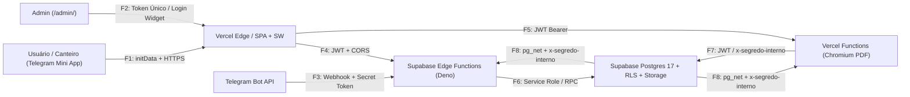
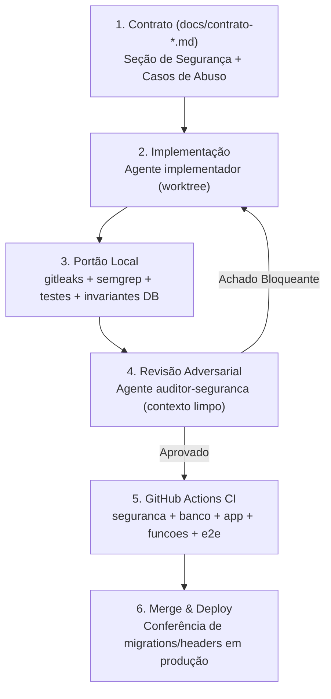

# Plano de Implementação da Camada de Segurança e Cibersegurança — Fiscal Bot (MINIAPPCOFZ)

> **Status:** Plano de implementação aprovado (execução incremental em 4 fases)  
> **Data:** 2026-11-20  
> **Escopo:** Todo o repositório (`app/`, `supabase/`, `.github/`, `.claude/`, `tests/db/`, `docs/`, `CLAUDE.md`)  
> **Objetivo:** Estabelecer defesa em profundidade em 7 camadas para o Fiscal Bot e incorporar rotinas determinísticas e adversariais de análise de segurança no fluxo de desenvolvimento assistido por IA.

---

## 1. Diagnóstico do Estado Atual

### O que já funciona bem e será preservado
- Validação de `initData` do Telegram via HMAC-SHA256 com comparação em tempo constante em `supabase/functions/_shared/init_data.ts`.
- Tokens de uso único para `/admin/` armazenados apenas como hash SHA-256 em `supabase/functions/admin-sessao/handler.ts`.
- CORS por allowlist explícita (`ALLOWED_ORIGINS`) em `supabase/functions/_shared/http.ts`.
- Autenticação interna banco → funções via `x-segredo-interno` (Supabase Vault) com comparação em tempo constante (`timingSafeEqual` / `igualConstante`).
- Funções `SECURITY DEFINER` com `search_path = ''` e suíte de testes de banco (`tests/db/`) contra PostgreSQL 17 no CI.

### Lacunas identificadas no código atual

| # | Severidade | Achado | Arquivo / Componente | Risco |
|---|---|---|---|---|
| 1 | **Alta** | Sem cabeçalhos de segurança HTTP e CSP | `app/vercel.json` | Clickjacking no `/admin/`, XSS sem contenção, MIME sniffing |
| 2 | **Alta** | Chromium headless sem bloqueio de rede/JS ao renderizar PDFs | `app/servidor/boletim/pdf.ts` | **SSRF** (metadados AWS/Vercel) ou exfiltração se houver injeção HTML |
| 3 | **Alta** | Sem rate limiting em endpoints públicos e geradores de PDF | `auth-telegram`, `admin-sessao`, `app/api/previa-boletim.ts`, `app/api/relatorio-pendencias.ts` | DoS / exaustão de memória (2 GB/chamada) e força bruta |
| 4 | **Média** | Cache do Service Worker mantém fotos/plantas após troca de usuário | `app/public/sw.js`, `app/src/dados/login.ts` | Vazamento local em dispositivos compartilhados no canteiro |
| 5 | **Média** | CI sem estágio de segurança (SAST, SCA, Secret Scanning, `permissions`) | `.github/workflows/ci.yml` | Regressões de segurança e dependências vulneráveis em produção |
| 6 | **Média** | `subDoJwt()` decodifica JWT sem verificação antes da RPC | `app/servidor/relatorio/http.ts` | Risco de confiança prematura em claim caso o fluxo seja refatorado |
| 7 | **Média** | Sem trilha de auditoria imutável e inventário LGPD formal | `supabase/migrations/` | Repúdio de ações administrativas e risco de conformidade (PII/fotos) |
| 8 | **Baixa** | Invariantes de Postgres (`RLS`, `search_path`, `GRANT`) sem teste global | `tests/db/`, `supabase/config.toml` | Nova tabela criada sem RLS ficar exposta via PostgREST |

---

## 2. Modelo de Ameaças (STRIDE nas Fronteiras de Confiança)



| Fronteira | Ameaças STRIDE | Controles Alvo |
|---|---|---|
| **F1 / F2 (Cliente ↔ Vercel)** | **S**poofing, **T**ampering, **I**nfo Disclosure | CSP estrito (`frame-ancestors 'none'` no `/admin/`, Telegram allowlist no `/`), HSTS, purga de cache SW/IndexedDB na troca de usuário |
| **F3 (Telegram ↔ `bot-webhook`)** | **S**poofing, **D**oS | `X-Telegram-Bot-Api-Secret-Token` em tempo constante, limite de tamanho do payload, rate limit |
| **F4 (Cliente ↔ Edge Functions)** | **S**poofing, **E**levation of Privilege, **D**oS | Validação explícita em 100% dos handlers (`verify_jwt = false`), rate limiting, CORS estrito |
| **F5 (Cliente ↔ Vercel PDF)** | **D**oS, **T**ampering (HTML/SSRF), **I**nfo Disclosure | Bloqueio total de rede e JS no Chromium, escape HTML testado, rate limit + concorrência por usuário |
| **F6 / F7 (App ↔ Postgres/Storage)** | **E**levation of Privilege, **I**nfo Disclosure | RLS habilitado em 100% de `public`, zero privilégios para `anon`, buckets privados com MIME/tamanho restritos |
| **F8 (Banco ↔ Funções Internas)** | **S**poofing, **R**epudiation | `x-segredo-interno` no Vault com rotação periódica e comparação em tempo constante |

---

## 3. Arquitetura da Camada de Cibersegurança (7 Camadas)

1. **Camada 1 — Borda e Navegador (Vercel):** HSTS, `X-Content-Type-Options`, `Referrer-Policy`, `Permissions-Policy`, CSP diferenciado para `/` (embutido no Telegram) e `/admin/` (`frame-ancestors 'none'`).
2. **Camada 2 — Identidade, Sessão e Isolamento Local:** Janela reduzida de replay do `initData`, `timebox`/`inactivity_timeout` no Supabase Auth, purga de Cache Storage/IndexedDB ao trocar de usuário no aparelho, eliminação de leitura não verificada de claims JWT.
3. **Camada 3 — Isolamento da Geração de PDF (Anti-SSRF / Anti-XSS):** `javaScriptEnabled: false`, interceptação de rede bloqueando tudo exceto `data:`/`about:`, testes de fuzzing/XSS nos templates HTML e validação de magic bytes em imagens.
4. **Camada 4 — Rate Limiting e Proteção contra Abuso (DoS):** Limite por IP em `auth-telegram` e `admin-sessao`; limite por `sub` e concorrência máxima em `previa-boletim` e `relatorio-pendencias`; teto explícito de tamanho de corpo JSON.
5. **Camada 5 — Blindagem de Dados e Storage (PostgreSQL 17):** Suíte automatizada de invariantes globais (`RLS`, `SECURITY DEFINER` com `search_path = ''`, revogação de `anon`, políticas de bucket sem `image/svg+xml`).
6. **Camada 6 — Auditoria, Logs e Privacidade (LGPD):** Tabela imutável `privado.auditoria_seguranca`, higiene de logs sem PII/tokens e inventário de dados pessoais com retenção e descarte.
7. **Camada 7 — Cadeia de Suprimentos e Segredos:** `permissions: contents: read` e pinning por SHA no CI, SCA (`npm audit`, `pip-audit`), secret scanning (`gitleaks`), Dependabot e política de rotação de segredos.

---

## 4. Plano de Implementação Detalhado (4 Fases)

Cada fase foi desenhada para caber em sessões curtas e independentes, com entregas verificáveis e sem quebrar o funcionamento em produção.

---

### Fase 1 — Blindagem Imediata (Quick Wins Críticos)

**Objetivo:** Fechar as vulnerabilidades de maior impacto (cabeçalhos HTTP/CSP, SSRF no Chromium, invariantes de RLS e portão de segurança no CI).

#### Tarefa 1.1 — Cabeçalhos de Segurança HTTP e CSP na Vercel
- **Arquivo:** `app/vercel.json`
- **Ação:** Adicionar seção `"headers"` mantendo `"functions"` e `"rewrites"` intactos:
  - `/(.*)`: `Strict-Transport-Security`, `X-Content-Type-Options: nosniff`, `Referrer-Policy: strict-origin-when-cross-origin`, `Permissions-Policy: geolocation=(self), microphone=(), payment=(), camera=(self)` *(geolocalização mantida em `self` para o check-in da Equipe de Serviço em campo; câmera em `self` para QR/RA)*.
  - `/admin` e `/admin/(.*)`:
    - `X-Frame-Options: DENY`
    - `Permissions-Policy: geolocation=(), microphone=(), payment=(), camera=()`
    - `Content-Security-Policy`: `default-src 'self'; frame-ancestors 'none'; frame-src https://oauth.telegram.org; script-src 'self' 'wasm-unsafe-eval' https://telegram.org; worker-src 'self' blob:; connect-src 'self' https://*.supabase.co; img-src 'self' data: blob: https://*.supabase.co https://tile.openstreetmap.org https://server.arcgisonline.com; style-src 'self' 'unsafe-inline'; object-src 'none'; base-uri 'self'` *(permite Telegram Login Widget, tiles Leaflet em `MapaEscolha.tsx` e conversão WASM/Worker de plantas PDF e IFC)*.
  - `/((?!admin|api).*)`:
    - `Content-Security-Policy`: `default-src 'self'; frame-ancestors https://web.telegram.org https://*.telegram.org; script-src 'self' 'wasm-unsafe-eval' https://telegram.org; worker-src 'self' blob:; connect-src 'self' https://*.supabase.co; img-src 'self' data: blob: https://*.supabase.co; style-src 'self' 'unsafe-inline'; object-src 'none'; base-uri 'self'` *(permite embutimento no Telegram e motor 3D/RA/WASM + Service Worker)*.
  - `/api/(.*)`: `Cache-Control: no-store`, `X-Content-Type-Options: nosniff`.
- **Estratégia de rollout:** Publicar primeiro com `Content-Security-Policy-Report-Only` em Preview Deploy da Vercel, validar todos os fluxos (Mini App + 3D/RA + check-in + SW; Admin + mapa Leaflet + conversão de planta/IFC + Login Widget) sem violações no console, e então promover para `Content-Security-Policy` em modo enforcement.

#### Tarefa 1.2 — Isolamento Anti-SSRF e Anti-XSS na Geração de PDF
- **Arquivos:** `app/servidor/boletim/pdf.ts`, `app/servidor/boletim/pdf.test.ts`, `app/servidor/boletim/template.test.ts`, `app/servidor/relatorio/template.test.ts`
- **Ação:**
  1. Em `gerarPdf()` (`app/servidor/boletim/pdf.ts`), criar o contexto com `javaScriptEnabled: false` e interceptar todas as requisições *(sem impacto em `capturarClima()`, que utiliza seu próprio `BrowserContext` isolado)*:
     ```ts
     const contexto = await navegador.newContext({ locale: 'pt-BR', javaScriptEnabled: false })
     await contexto.route('**/*', (route) => {
       const url = route.request().url()
       if (url.startsWith('data:') || url.startsWith('about:')) return route.continue()
       return route.abort('blockedbyclient')
     })
     ```
  2. Validar explicitamente em teste com Chromium (`BOLETIM_EXIGIR_CHROMIUM=1`) que `pagina.evaluate(() => document.fonts.ready)` continua carregando as fontes embutidas sob `javaScriptEnabled: false` (se necessário, substituir por espera determinística de fontes sem regressão visual).
  3. Adicionar testes automatizados comprovando que:
     - Uma tentativa de carregar `` ou `<link rel="stylesheet" href="http://169.254.169.254/...">` durante `gerarPdf()` é bloqueada e nenhuma requisição externa sai.
     - Payloads XSS/HTML injection em nomes de obra, etapa, descrição de pendência e observação são escapados tanto no boletim quanto no relatório de pendências.

#### Tarefa 1.3 — Suíte de Invariantes de Segurança do Banco de Dados
- **Arquivo novo:** `tests/db/test_seguranca_invariantes.py`
- **Ação:** Criar testes contra o schema migrado no PostgreSQL 17 que falham automaticamente se qualquer migration violar:
  1. **RLS obrigatório:** Toda tabela ordinária (`relkind = 'r'`) no schema `public` possui `relrowsecurity = true` e pelo menos uma policy (ou está em allowlist explícita e comentada).
  2. **Isolamento de `anon`:** Role `anon` não possui `SELECT/INSERT/UPDATE/DELETE` em tabelas de `public`, nem `EXECUTE` em funções fora de uma allowlist mínima.
  3. **`SECURITY DEFINER` seguro:** Toda função `prosecdef = true` em `public` e `privado` possui `search_path=` explícito em `proconfig` (ex.: `search_path=""`) e não tem `EXECUTE` concedido a `PUBLIC`.
  4. **Views seguras:** Views em `public` não contornam RLS inadvertidamente (`security_invoker = true` quando aplicável).

#### Tarefa 1.4 — Portão de Segurança no CI e Hardening do Workflow
- **Arquivos:** `.github/workflows/ci.yml`, `.github/dependabot.yml` (novo)
- **Ação:**
  1. Adicionar `permissions: contents: read` no nível raiz de `.github/workflows/ci.yml`.
  2. Criar job `seguranca` executando:
     - **Gitleaks** (detecção de segredos em commits/PRs).
     - **Semgrep** (SAST para TypeScript, Deno, Python e regras customizadas do projeto).
     - **SCA:** `npm audit --omit=dev --audit-level=high` em `app/` e `pip-audit -r scripts/requirements.txt`.
  3. Criar `.github/dependabot.yml` monitorando `npm` (`/app`), `pip` (`/` e `/scripts`) e `github-actions` semanalmente.

#### Critério de Pronto da Fase 1
- `pytest -q tests/db` (incluindo `test_seguranca_invariantes.py`) passando 100%.
- `cd app && npm test && BOLETIM_EXIGIR_CHROMIUM=1 npx vitest run servidor` passando com os novos testes anti-SSRF/XSS.
- Job `seguranca` verde no GitHub Actions.
- Preview Deploy na Vercel verificado sem violações de CSP em `/` e `/admin/`.

---

### Fase 2 — Rotinas de Análise de Segurança no Desenvolvimento Assistido por IA

**Objetivo:** Integrar segurança diretamente no fluxo de trabalho com agentes de IA (`CLAUDE.md`, subagentes, hooks locais e contratos), tornando a análise automática e independente de quem gerou o código.

#### Tarefa 2.1 — Guardrails de Segurança no `CLAUDE.md` e Bloqueio de Segredos
- **Arquivos:** `CLAUDE.md`, `.claude/settings.local.json`
- **Ação:**
  1. Adicionar seção `## Segurança` no `CLAUDE.md` com as 3 faixas:
     - **Sempre fazer:** validar entrada nas fronteiras; `SET search_path = ''` + `REVOKE ALL FROM public, anon` em RPCs `SECURITY DEFINER`; habilitar RLS em toda tabela nova; escapar HTML em templates de PDF; escrever ao menos 1 **teste de abuso** por feature que toque acesso ou dados.
     - **Perguntar ao usuário antes:** alterar autenticação/sessão, mudar CORS/CSP, adicionar dependência nova, criar Edge Function com `verify_jwt = false` ou alterar buckets de Storage.
     - **Nunca fazer:** ler/expor `.env` ou segredos, desabilitar RLS/CSP/CORS para passar teste, usar `dangerouslySetInnerHTML`/`innerHTML`/`eval`, rodar `npm audit fix --force` sem revisão.
  2. Configurar negação de leitura/escrita para `.env`, `*.pem`, `*.key` em `.claude/settings.local.json` (se suportado pelo ambiente local).

#### Tarefa 2.2 — Criar Subagente Especialista `.claude/agents/auditor-seguranca.md`
- **Arquivo novo:** `.claude/agents/auditor-seguranca.md`
- **Especificação do agente:**
  - **Modo:** Somente leitura (`tools: Read, Grep, Glob, Bash` sem edição/commit/push), contexto limpo (nunca reaproveita o histórico do `implementador`).
  - **Gatilho obrigatório no fluxo:** Acionado antes do merge sempre que o diff tocar em `supabase/migrations/`, `supabase/functions/`, `app/api/`, `app/servidor/`, `app/vercel.json`, `app/public/sw.js`, `app/src/dados/login.ts` ou `package.json`.
  - **Roteiro de auditoria:**
    1. Ler apenas `git diff` + trechos conectados.
    2. Verificar: AuthN/AuthZ (IDOR/BOLA entre obras/etapas), invariantes RLS/`SECURITY DEFINER`, injeção SQL/HTML/XSS/SSRF, vazamento em logs/erros/cache SW, novas dependências (typosquatting/licença/necessidade).
    3. Emitir relatório curto com classificação **Bloqueante / Importante / Sugestão**, citando `arquivo:linha` e cenário concreto de abuso.

#### Tarefa 2.3 — Regras SAST Customizadas (`.semgrep/fiscal-bot.yml`) e Pre-commit
- **Arquivos novos:** `.semgrep/fiscal-bot.yml`, `.pre-commit-config.yaml` (ou script em `scripts/verificar_seguranca.sh`)
- **Regras customizadas mínimas para o Fiscal Bot:**
  1. Bloquear `dangerouslySetInnerHTML`, `innerHTML`, `eval(`, `new Function(`.
  2. Alertar em `setContent(` sem `javaScriptEnabled: false` ou sem bloqueio de rotas no contexto Playwright.
  3. Alertar em `console.log`/`console.warn`/`console.error` que referenciem variáveis sensíveis (`initData`, `token`, `segredo`, `authorization`, `jwt`, `password`).
  4. Alertar em `CREATE TABLE public.` sem `ENABLE ROW LEVEL SECURITY` no mesmo arquivo de migration.
  5. Executar `gitleaks protect --staged --redact` antes de cada commit.

#### Tarefa 2.4 — Seção de Segurança Obrigatória nos Contratos (`docs/contrato-*.md`)
- **Arquivo:** `docs/template-contrato-seguranca.md` (ou incluir no guia de contratos / `CLAUDE.md`)
- **Formato padrão (5 linhas) a incluir em todo novo contrato:**
  ```markdown
  ## Segurança (revisão de contrato)
  - **Fronteiras tocadas:** (ex.: RPC Postgres + Edge Function + Tela Admin)
  - **Autorização:** (ex.: apenas `admin_app`; gestor/equipe recebe `42501`)
  - **Dados sensíveis / PII:** (ex.: nome, username, foto de canteiro)
  - **Casos de abuso a testar:** (ex.: usuário da obra A tenta ler/editar registro da obra B; payload > limite)
  ```

#### Critério de Pronto da Fase 2
- `CLAUDE.md` atualizado e `.claude/agents/auditor-seguranca.md` criado.
- `semgrep --config .semgrep/fiscal-bot.yml` rodando sem falsos positivos bloqueantes no repositório atual.
- `gitleaks` validado localmente em teste com segredo fictício (bloqueando o commit).

---

### Fase 3 — Defesa de Borda, Rate Limiting e Isolamento de Sessão

**Objetivo:** Proteger recursos caros (Chromium 2 GB) contra DoS, impedir força bruta em autenticação e eliminar vazamento de cache offline entre usuários no mesmo dispositivo.

#### Tarefa 3.1 — Purga de Cache do Service Worker e IndexedDB na Troca de Usuário
- **Arquivos:** `app/public/sw.js`, `app/src/dados/login.ts`, `app/src/dados/login.test.ts`, `app/e2e/sw.spec.ts`
- **Ação:**
  1. Em `app/public/sw.js`, tratar nova mensagem `'limpar-caches-usuario'` apagando `fotos-v1`, `plantas-v1` e `modelos-v1` (mantendo o precache estático `app-*`, `motor-3d-v1` e `externos-v1`).
  2. Em `app/src/dados/login.ts`, quando detectar troca de `telegram_id` (linhas 53–59) ou logout explícito, disparar a mensagem ao Service Worker ativo e limpar os stores de dados de usuário no IndexedDB.
  3. Cobrir com teste unitário (`login.test.ts`) e E2E (`sw.spec.ts`).

#### Tarefa 3.2 — Rate Limiting em Endpoints Públicos e Geradores de PDF
- **Arquivos:** nova migration `supabase/migrations/<ts>_rate_limit.sql`, `supabase/functions/_shared/rate_limit.ts`, `supabase/functions/auth-telegram/handler.ts`, `supabase/functions/admin-sessao/handler.ts`, `app/servidor/boletim/http.ts`, `app/servidor/relatorio/http.ts`
- **Ação:**
  1. Criar tabela `privado.rate_limit` + RPC atômica `privado.consumir_cota(p_chave text, p_limite int, p_janela_segundos int) returns boolean` (com limpeza periódica via `pg_cron`), evitando dependência externa adicional.
  2. Aplicar limites iniciais calibrados para não atrapalhar edição legítima:
     - `auth-telegram`: 20 req / 5 min por IP (ou `x-forwarded-for` normalizado).
     - `admin-sessao` (`trocar`, `widget`): 10 req / 15 min por IP.
     - `previa-boletim` (admin editando boletim): **15 req / 5 min** por `usuario_id`.
     - `relatorio-pendencias` (equipe): **5 req / 5 min** por `usuario_id`.
  3. Retornar `429 Too Many Requests` com `Retry-After` e corpo JSON genérico.

#### Tarefa 3.3 — Eliminação de Claim JWT Não Verificado e Limites de Payload
- **Arquivos:** `app/servidor/relatorio/http.ts`, `app/servidor/boletim/http.ts`, `supabase/functions/*/handler.ts`
- **Ação:**
  1. Em `app/servidor/relatorio/http.ts`, usar o `usuario_id` validado pela RPC `relatorio_pendencias` (ou `auth.getUser(jwt)`) para montar o caminho `pendencias/<usuario_id>/...`, removendo a dependência de `subDoJwt()` sem assinatura.
  2. Validar `Content-Length` (máximo 64 KB para payloads JSON de API/Edge Functions) antes de chamar `req.json()`.
  3. Conferir que `tipoDaImagem()` e os fluxos de upload validam **magic bytes** reais (JPEG/PNG/WebP) e rejeitam `image/svg+xml`.

#### Critério de Pronto da Fase 3
- Testes de rate limiting (429 após exceder cota) em Deno, Vitest e `tests/db/`.
- Teste confirmando purga de `fotos-v1`/`plantas-v1`/`modelos-v1` ao trocar de usuário.
- Nenhum uso de `subDoJwt` sem verificação prévia.

---

### Fase 4 — Auditoria Imutável, Sessões e Conformidade LGPD

**Objetivo:** Garantir rastreabilidade de eventos críticos de segurança (anti-repúdio), endurecer sessões no Supabase e formalizar governança de dados pessoais.

#### Tarefa 4.1 — Trilha de Auditoria Imutável (`privado.auditoria_seguranca`)
- **Arquivos:** nova migration `supabase/migrations/<ts>_auditoria_seguranca.sql`, `tests/db/test_auditoria_seguranca.py`
- **Ação:**
  1. Criar tabela `privado.auditoria_seguranca (id uuid, ocorrido_em timestamptz, ator_id uuid, acao text, alvo_tipo text, alvo_id text, detalhes jsonb)` acessível apenas via `service_role` e RPCs `SECURITY DEFINER` (sem `UPDATE`/`DELETE` para roles da aplicação).
  2. Instrumentar eventos críticos:
     - Alteração de acesso (`definir_acesso`), promoção/remoção em `admin_app`.
     - Exclusão de obra, etapa e boletim (`admin_excluir_*`).
     - Criação/consumo de entrada admin (`admin_entrada_*`) e falhas repetidas de autenticação.
  3. Garantir nos testes que nenhum token, `initData` ou dado pessoal sensível entra em `detalhes`.

#### Tarefa 4.2 — Hardening de Sessões e Configuração do Supabase
- **Arquivos:** `supabase/config.toml` + conferência no painel Supabase Cloud
- **Ação:**
  1. Avaliar e ativar `[auth.sessions]` com foco restritivo no portal `/admin/`, preservando a resiliência offline do Mini App em canteiros com sinal intermitente.
  2. Calibrar `IDADE_MAXIMA_MS` em `supabase/functions/_shared/init_data.ts` para **6h–12h** (em vez de 24h, sem quebrar fiscais que mantêm o WebView aberto durante o turno em campo).
  3. Ativar `db.ssl_enforcement` em produção e revisar `auto_expose_new_tables = false` em `supabase/config.toml`.

#### Tarefa 4.3 — Inventário de Dados (LGPD) e Política de Rotação de Segredos
- **Arquivo novo:** `docs/privacidade-e-operacao-seguranca.md`
- **Ação:**
  1. Documentar inventário de PII (`usuario`, fotos de canteiro, registros de presença/check-in), base legal/finalidade, prazo de retenção e procedimento de anonimização/exclusão.
  2. Documentar runbook de rotação sem indisponibilidade para: `x-segredo-interno` (Vault + Vercel), `TELEGRAM_BOT_TOKEN`, `SUPABASE_SERVICE_ROLE_KEY` e tokens de deploy.
  3. Definir cadência operacional:
     - **A cada PR:** CI (`seguranca` + `banco`) + `auditor-seguranca` em mudanças críticas.
     - **Mensal:** revisão de `admin_app`, logs de `auditoria_seguranca`, `npm audit`/`pip-audit` e órfãos no Storage.
     - **Trimestral:** teste de cabeçalhos HTTP em produção, revisão de penetração/DAST em staging e rotação de segredos internos.

#### Critério de Pronto da Fase 4
- `privado.auditoria_seguranca` testada em `tests/db/` e aplicada em produção.
- Configurações de sessão/SSL conferidas no Supabase Cloud.
- Runbook de LGPD e rotação de segredos versionado em `docs/`.

---

## 5. Avaliação de Impactos e Mitigações

| Dimensão | Impacto Esperado | Mitigação Incorporada no Plano |
|---|---|---|
| **Funcionalidades do Admin (Mapa, Login Widget, Conversores)** | Médio risco se CSP fosse genérico (quebraria tiles Leaflet, iframe `oauth.telegram.org` e WASM/Workers). | Diretivas explícitas na Tarefa 1.1 + rollout inicial via `Content-Security-Policy-Report-Only`. |
| **Mini App em Canteiro (GPS, 3D/RA, Offline)** | Risco de bloquear GPS do check-in ou expirar `initData` durante o turno sem sinal. | `geolocation=(self)` em `/`, `'wasm-unsafe-eval'` + `worker-src 'self' blob:`, e `IDADE_MAXIMA_MS` calibrado em 6h–12h. |
| **Geração de Boletim e Clima (Chromium)** | Sem impacto na captura do clima (`capturarClima()` usa contexto separado); validar carregamento de fontes com JS desligado. | Teste real com `BOLETIM_EXIGIR_CHROMIUM=1` na Tarefa 1.2. |
| **UX / Troca de Usuário e Edição de Boletim** | Purga do cache SW exige novo download apenas ao trocar de conta no mesmo aparelho; prévias frequentes poderiam bater em rate limit baixo. | Purga restrita à troca de `telegram_id`/logout; `previa-boletim` calibrado em 15 req / 5 min. |
| **Performance e Custos** | Headers/CSP = 0 ms / R$ 0; `privado.rate_limit` = +5–15 ms apenas em login/PDF; `auditoria_seguranca` = +1 `INSERT` (< 5 ms) em ações admin. | Nenhuma infraestrutura paga externa (Redis/WAF) obrigatória nesta etapa. |
| **CI/CD e Consumo de Tokens (IA)** | Job `seguranca` roda em paralelo ao `e2e` (não aumenta tempo total do CI); `test_seguranca_invariantes.py` pode exigir allowlist/ajuste inicial em tabelas legadas. | `auditor-seguranca` acionado apenas quando o diff toca superfícies críticas. |

---

## 6. Resumo do Fluxo de Trabalho Diário (IA-DevSecOps)



---

## 7. Checklist de Acompanhamento

### Fase 1 — Blindagem Imediata
- [ ] **1.1** Cabeçalhos HTTP e CSP em `app/vercel.json`
- [ ] **1.2** Bloqueio de rede/JS no Chromium em `app/servidor/boletim/pdf.ts` + testes anti-SSRF/XSS
- [ ] **1.3** `tests/db/test_seguranca_invariantes.py` (RLS, `anon`, `SECURITY DEFINER`)
- [ ] **1.4** Job `seguranca` + `permissions: contents: read` em `.github/workflows/ci.yml` e `.github/dependabot.yml`

### Fase 2 — Rotina IA-DevSecOps
- [ ] **2.1** Seção de segurança no `CLAUDE.md` + bloqueio de leitura de `.env`
- [ ] **2.2** Novo subagente `.claude/agents/auditor-seguranca.md`
- [ ] **2.3** Regras `.semgrep/fiscal-bot.yml` + pre-commit com `gitleaks`
- [ ] **2.4** Padrão de seção de segurança nos contratos (`docs/contrato-*.md`)

### Fase 3 — Defesa de Borda e Sessão
- [ ] **3.1** Purga de cache SW/IndexedDB na troca de usuário (`sw.js` + `login.ts`)
- [ ] **3.2** Rate limiting (`privado.rate_limit`) em Auth e geradores de PDF
- [ ] **3.3** Remoção de `subDoJwt` não verificado + limites de payload e validação de magic bytes

### Fase 4 — Auditoria e Conformidade
- [ ] **4.1** Tabela `privado.auditoria_seguranca` + instrumentação de ações críticas
- [ ] **4.2** Hardening de sessões, `initData` e `supabase/config.toml`
- [ ] **4.3** Runbook de LGPD e rotação de segredos (`docs/privacidade-e-operacao-seguranca.md`)
